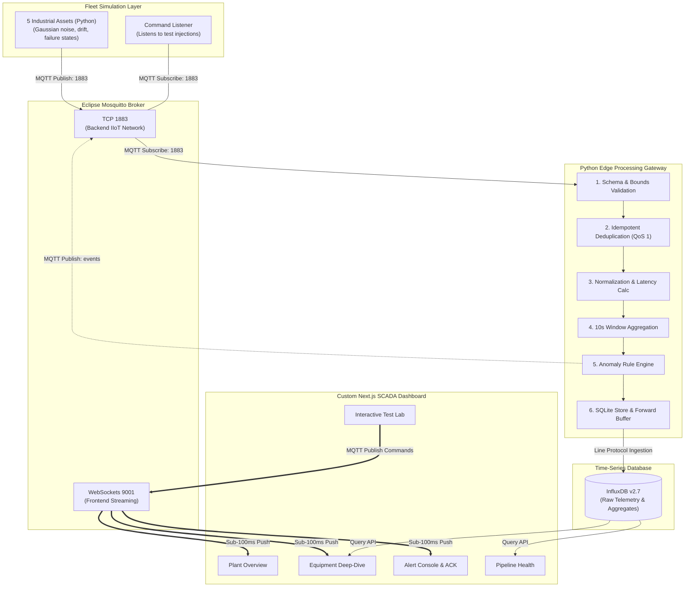

# End-to-End Industrial IoT Pipeline (IIoT 4.0)
## Sensors Simulation → Edge Computing Gateway → Real-Time SCADA Operations Center
**ENSAM Rabat — Master & Ingénierie Industrie 4.0 (Année 2026–2027)**  
**Encadrement : Professeure Maria ZEMZAMI**

---

## 1. Project Overview

This project implements a complete, containerized cyber-physical Industrial IoT system conforming to Industrie 4.0 principles, OASIS MQTT 5.0 standards, and NIST SP 800-82 OT cybersecurity guidelines.

Instead of generic passive monitoring tools, this system features a custom-built industrial SCADA Operations Center developed in Next.js 14/15, Tailwind CSS, and shadcn/ui components. The dashboard communicates directly with an Eclipse Mosquitto broker over WebSockets (port 9001) for true sub-100ms real-time streaming, while persisting time-series historical data and aggregations into InfluxDB v2.

### Key Capabilities
- **Fleet Simulation**: 5 distinct industrial assets (`motor-01`, `motor-02`, `pump-01`, `compressor-01`, `conveyor-01`) producing calibrated physical variables (temperature, line pressure, RMS vibration velocity, humidity) with Gaussian noise and deterministic seeds.
- **Intelligent Edge Gateway**:
  - Schema and physical bounds validation using Pydantic v2.
  - Idempotent deduplication cache (10,000-key LRU) handling MQTT QoS 1 retries.
  - Edge normalization, latency tracking, and 10-second rolling window statistical aggregations.
  - Deterministic anomaly detection rules emitting alarms over MQTT.
  - Store-and-Forward local SQLite resilience buffer tolerating storage outages.
- **Custom SCADA Operations Center**:
  - **Plant Overview**: Plant health status, live asset grid, KPI cards.
  - **Equipment Telemetry**: Digital twin view, dynamic gauges, multi-variable real-time time-series charts.
  - **Alert Console**: Operator incident management with workflow acknowledgment (ACK) and CSV reporting.
  - **Interactive Test Lab**: Oral defense controller allowing evaluators to inject thermal faults, vibration spikes, pressure collapses, or malformed packets in real time.
  - **Pipeline Health**: Quantitative metrics measuring p50/p95 latency and ingestion throughput.

---

## 2. Architecture



---

## 3. Quick Start (Single Command)

### Prerequisites
- Docker & Docker Compose installed.

### Launching the Stack
Clone the repository and run:

```bash
docker compose up --build -d
```

### Access URLs
| Service | URL / Port | Credentials / Details |
|---|---|---|
| **SCADA Web Dashboard** | `http://localhost:3000` | Real-time Operations Center |
| **Mosquitto MQTT Broker** | `localhost:1883` (TCP), `localhost:9001` (WS) | MQTT 5.0 / WebSockets |
| **InfluxDB UI** | `http://localhost:8086` | User: `ensam_admin` / Pass: `ensam_industrie40_password` |

To stop the entire stack:
```bash
docker compose down
```

---

## 4. Oral Defense Demonstration Script (7 to 10 Minutes)

1. **Architecture & Topology**:
   - Present the pipeline layers: Simulator → Mosquitto (TCP 1883 / WS 9001) → Edge Gateway → InfluxDB → Next.js Dashboard.
2. **Plant Overview**:
   - Open `http://localhost:3000`. Show the 5 assets running and reporting continuous metrics sub-100ms without browser refresh.
3. **Equipment Deep-Dive**:
   - Switch to **Equipment Telemetry** tab. Select `motor-01` or `pump-01`. Show the live dynamic dials and the real-time Recharts curve.
4. **Interactive Fault Injection (Jury Test Lab)**:
   - Switch to **Test Lab & Fault Injector** tab.
   - Select `motor-01` and click **"Inject Thermal Fault"** or **"Inject Vibration Spike"**.
   - Observe the live command feedback log.
   - Return to **Equipment Telemetry** or **Plant Overview**: show the variable exceeding the threshold and transitioning the asset badge from `RUNNING` to `CRITICAL`.
5. **Operator Alert Acknowledgment**:
   - Switch to **Alert Console**. Show the newly triggered incident with diagnostic reason.
   - Click **Acknowledge**, enter a maintenance note, and confirm. Show the event marked as acknowledged.
6. **Edge Validation & Rejection Verification**:
   - From the Test Lab, click **"Inject Bad Payload"**.
   - Show in the Edge logs (`docker logs ensam_iiot_edge`) that the corrupted frame was rejected and quarantined by Pydantic before reaching the database.
7. **Pipeline Metrics & Performance Verification**:
   - Switch to **Pipeline Health**. Verify sustained throughput (&gt; 10 msg/s) and Edge processing latency (p95 &lt; 100 ms).

---

## 5. Automated Tests & Academic Benchmarks

### Running Unit Tests
```bash
python -m pytest tests/
```

### Running Experimental Latency & QoS Benchmark
With Mosquitto running, execute:
```bash
python scripts/run_benchmark.py
```
This script computes roundtrip latencies (mean, median, p50, p90, p95, p99) and delivery rates comparing QoS 0 vs QoS 1, producing formatted results for inclusion in the final project report.

---

## 6. Project Structure

```text
.
├── dashboard/                  # Custom SCADA Operations Center (Next.js 14/15, Tailwind, shadcn)
│   ├── src/
│   │   ├── app/                # App router (layout.tsx, page.tsx, globals.css)
│   │   ├── components/         # PlantOverview, DeviceDetail, AlertConsole, TestLab, PipelineMetrics
│   │   ├── hooks/              # useMqttStream (WebSocket MQTT streaming hook)
│   │   └── types/              # TypeScript definitions for IIoT telemetry & events
│   ├── Dockerfile              # Multi-stage optimized standalone production image
│   └── package.json
├── edge/                       # Edge Computing Gateway (Python 3.12)
│   ├── src/
│   │   ├── validation.py       # Pydantic v2 schema & physical bounds validation
│   │   ├── deduplication.py    # Idempotent LRU deduplication cache
│   │   ├── normalization.py    # Metadata enrichment & latency calculation
│   │   ├── aggregation.py      # 10-second rolling window statistical calculations
│   │   ├── anomaly_rules.py    # Industrial threshold rules engine
│   │   ├── storage.py          # InfluxDB persistence & SQLite store-and-forward buffer
│   │   └── main.py             # Event loop & MQTT consumer
│   └── Dockerfile
├── simulator/                  # Industrial Equipment Simulator (Python 3.12)
│   ├── src/
│   │   ├── devices.py          # Asset models (Motor, Pump, Compressor, Conveyor)
│   │   ├── models.py           # Pydantic data contracts
│   │   ├── mqtt_publisher.py   # Telemetry publisher & fault injection command listener
│   │   └── main.py             # Main simulation runner
│   └── Dockerfile
├── infrastructure/
│   └── mosquitto/
│       └── config/mosquitto.conf # Mosquitto config (listeners 1883 TCP & 9001 WS)
├── tests/                      # Automated test suite (pytest)
│   ├── test_simulator.py
│   ├── test_validation.py
│   └── test_anomaly_rules.py
├── scripts/
│   └── run_benchmark.py        # QoS latency & throughput benchmark generator
├── docker-compose.yml          # Full-stack multi-container deployment
├── .env.example                # Template configuration parameters
└── README.md
```

