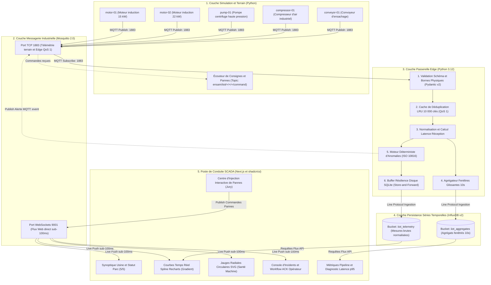
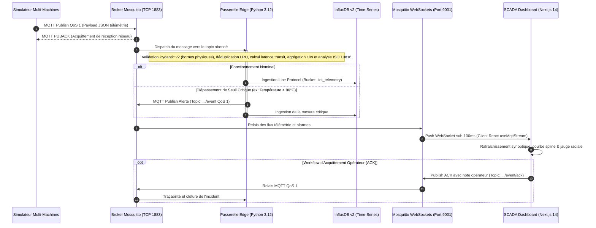
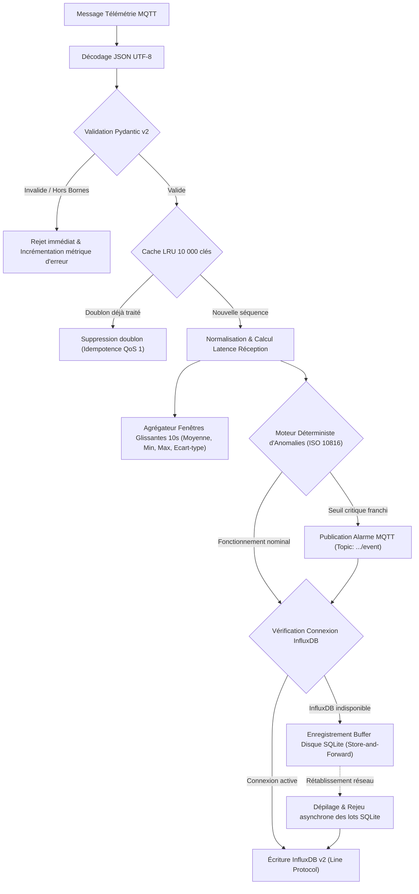
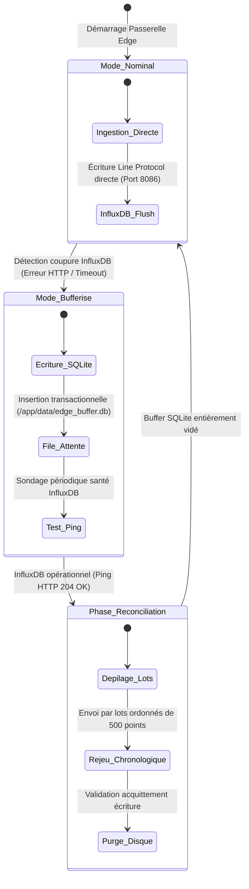
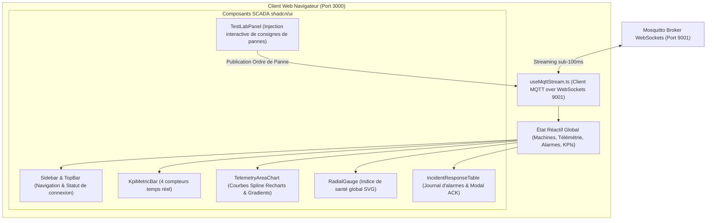
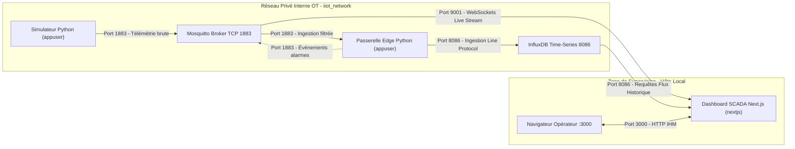

# Pipeline IIoT End-to-End & Poste de Conduite SCADA Temps Réel
### Master & Ingénierie Industrie 4.0 — ENSAM Rabat (2026–2027)
**Projet Académique & Industriel de Fin d'Études**  
**Encadrement : Professeure Maria ZEMZAMI**

---

[](https://github.com)
[](https://www.docker.com)
[](docs/architecture.md)
[](https://python.org)
[](https://nextjs.org)
[](https://mosquitto.org)
[](https://www.influxdata.com)
[](docs/security.md)

---

## Sommaire

1. [Résumé Exécutif & Problématique Industrielle](#1-résumé-exécutif--problématique-industrielle)
2. [Architecture Globale du Système](#2-architecture-globale-du-système)
3. [Cycle de Vie d'une Trame de Télémétrie](#3-cycle-de-vie-dune-trame-de-télémétrie)
4. [Passerelle Edge Intelligente & Traitements de Données](#4-passerelle-edge-intelligente--traitements-de-données)
5. [Moteur de Simulation Multi-Équipements & Modèles Physiques](#5-moteur-de-simulation-multi-équipements--modèles-physiques)
6. [Poste de Conduite SCADA Temps Réel (Next.js & shadcn/ui)](#6-poste-de-conduite-scada-temps-réel-nextjs--shadcnui)
7. [Persistance Chronologique & Modélisation InfluxDB v2](#7-persistance-chronologique--modélisation-influxdb-v2)
8. [Résultats Empiriques & Benchmarks de Performance](#8-résultats-empiriques--benchmarks-de-performance)
9. [Cybersécurité Industrielle & Conformité NIST SP 800-82 Rev. 3](#9-cybersécurité-industrielle--conformité-nist-sp-800-82-rev-3)
10. [Guide de Déploiement & Démarrage Pas à Pas](#10-guide-de-déploiement--démarrage-pas-à-pas)
11. [Scénario de Démonstration Orale (Soutenance 7 à 10 min)](#11-scénario-de-démonstration-orale-soutenance-7-à-10-min)
12. [Tests Automatisés & Assurance Qualité](#12-tests-automatisés--assurance-qualité)
13. [Arborescence du Répertoire & Organisation](#13-arborescence-du-répertoire--organisation)
14. [Dossier Documentaire d'Ingénierie](#14-dossier-documentaire-dingénierie)

---

## 1. Résumé Exécutif & Problématique Industrielle

Dans une usine connectée (**Usine 4.0**), la convergence entre les réseaux opérationnels (**OT** - *Operational Technology*) et les systèmes informatiques décisionnels (**IT** - *Information Technology*) représente un défi majeur. Les automates programmables industriels (API/PLC), capteurs et machines tournantes produisent des volumes considérables de télémétrie hétérogène à haute cadence. L'acheminement direct et passif de ce flux brut vers le Cloud ou des bases de données centrales souffre de limites critiques :
- **Saturation de la bande passante** et latences imprévisibles incompatibles avec la surveillance critique.
- **Vulnérabilité aux coupures réseau** entraînant des pertes de traçabilité irréversibles.
- **Manque de réactivité des IHM traditionnelles** basées sur des requêtes HTTP périodiques (polling) toutes les quelques secondes, inaptes à signaler une anomalie mécanique en temps réel.

### Objectifs Clés du Projet
Pour répondre à ce cahier des charges académique et industriel à l'**ENSAM Rabat**, ce projet conçoit, industrialise et conteneurise un **pipeline cyber-physique complet de bout en bout** intégrant :
1. **Simulation physique multi-machines** : 5 actifs industriels distincts modélisés avec distribution gaussienne réaliste, bruits thermomécaniques et graines pseudo-aléatoires déterministes.
2. **Messagerie industrielle standardisée** : Protocole OASIS MQTT 5.0 avec garanties de livraison QoS 1 (At Least Once) et double écouteur TCP (1883) et WebSockets natif (9001).
3. **Passerelle Edge Computing résiliente** : Nœud de calcul autonome réalisant la validation stricte de schémas (Pydantic v2), la déduplication idempotente par cache LRU, l'agrégation statistique fenêtrée sur 10 secondes, la détection déterministe d'anomalies (norme vibratoire ISO 10816), et un mécanisme de résilience *Store-and-Forward* sur disque local SQLite en cas de défaillance du réseau ou de la base.
4. **Persistance chronologique partitionnée** : Base de séries temporelles InfluxDB v2 avec compartimentation stricte entre données haute fréquence brutes (`iiot_telemetry`) et séries agrégées (`iiot_aggregates`).
5. **Poste de conduite SCADA haute performance** : Interface sur-mesure développée en **Next.js 14**, Tailwind CSS et **shadcn/ui**, connectée directement au broker en **WebSockets MQTT**, affichant le flux opérationnel avec une **latence sub-100ms** et intégrant un banc d'essai d'injection interactive de défaillances.

---

## 2. Architecture Globale du Système

L'architecture distribuée respecte la séparation en couches étanches selon le standard international **ISA-95** :



---

## 3. Cycle de Vie d'une Trame de Télémétrie

Le diagramme de séquence ci-après illustre le flux bidirectionnel complet entre l'émetteur physique, le filtre Edge, la base chronologique et le poste de conduite SCADA :



---

## 4. Passerelle Edge Intelligente & Traitements de Données

La passerelle Edge (`edge/src/main.py`) constitue le cœur logique du traitement en bordure de réseau. Elle réalise 6 opérations séquentielles à haute valeur ajoutée sans dépendre d'un serveur central distant :



### 4.1 Description Détaillée des Modules Edge

| Module Python | Fichier Source | Rôle & Algorithme Appliqué |
|---|---|---|
| **Validation & Intégrité** | [`validation.py`](edge/src/validation.py) | Contrôle syntaxique JSON et typage strict via **Pydantic v2**. Vérification des bornes de plausibilité physique :<br/>- Température : $[-30.0^\circ\text{C}, 180.0^\circ\text{C}]$<br/>- Pression : $[0.0\text{ bar}, 50.0\text{ bar}]$<br/>- Vibration RMS : $[0.0\text{ mm/s}, 50.0\text{ mm/s}]$<br/>- Humidité : $[0.0\%, 100.0\%]$ |
| **Déduplication Idempotente** | [`deduplication.py`](edge/src/deduplication.py) | En protocole MQTT QoS 1, les acquittements perdus provoquent des renvois légitimes. Un **cache LRU** borné à 10 000 clés indexé sur le couple `(device_id, sequence)` neutralise les doublons sans altérer les métriques statistiques. |
| **Normalisation & Transit** | [`normalization.py`](edge/src/normalization.py) | Horodatage de réception UTC précis (`edge_received_at`) et calcul instantané de la latence réseau de transit :<br/>$$\text{Latence Transit} = T_{\text{Edge}} - T_{\text{Capteur}}$$ |
| **Agrégation Glissante 10s** | [`aggregation.py`](edge/src/aggregation.py) | Maintien en mémoire d'une fenêtre temporelle glissante de 10 secondes par équipement. Calcul statistique en continu : $\mu$ (Moyenne), $\min$, $\max$, $\sigma$ (Écart-type) et volume d'échantillons. Injection dédiée dans le compartiment `iiot_aggregates`. |
| **Moteur d'Anomalies** | [`anomaly_rules.py`](edge/src/anomaly_rules.py) | Moteur de règles déterministes explicables :<br/>- **Thermique** : Warning $> 80^\circ\text{C}$, Critical $> 90^\circ\text{C}$<br/>- **Vibratoire (ISO 10816-3)** : Warning $> 4.0\text{ mm/s}$, Critical $> 5.5\text{ mm/s}$ (rupture imminente)<br/>- **Pression** : Warning $< 2.5\text{ bar}$ ou $> 9.5\text{ bar}$ |
| **Buffer Store-and-Forward** | [`storage.py`](edge/src/storage.py) | Tolérance aux pannes certifiée NIST SP 800-82 : bascule instantanée sur base persistante SQLite locale (`/app/data/edge_buffer.db`) en cas de coupure InfluxDB, puis vidage ordonné automatique par lots de 500 points à la reprise. |

### 4.2 Machine à États de la Résilience *Store-and-Forward*



---

## 5. Moteur de Simulation Multi-Équipements & Modèles Physiques

Le simulateur industriel (`simulator/src/`) est développé en Python 3.12 asynchrone (`asyncio`). Il émule le comportement de 5 actifs de production avec dynamique physique continue, injection de bruit blanc gaussien et répétabilité exacte grâce à des graines déterministes (`seed`).

### 5.1 Calibrage des Équipements de la Flotte

| Identifiant Machine | Type d'Actif Industriel | Emplacement ISA-95 | Température ($\mu \pm \sigma$) | Pression ($\mu \pm \sigma$) | Vibration RMS ($\mu \pm \sigma$) | Humidité ($\mu \pm \sigma$) | Fréquence |
|---|---|---|:---:|:---:|:---:|:---:|:---:|
| `motor-01` | Moteur induction 15 kW | `site-a/line-1` | $65.0 \pm 1.8^\circ\text{C}$ | $1.00 \pm 0.05\text{ bar}$ | $2.10 \pm 0.15\text{ mm/s}$ | $42.0 \pm 1.2\%$ | 1.0 Hz |
| `motor-02` | Moteur induction 22 kW | `site-a/line-2` | $72.0 \pm 2.2^\circ\text{C}$ | $1.02 \pm 0.04\text{ bar}$ | $2.60 \pm 0.20\text{ mm/s}$ | $44.0 \pm 1.5\%$ | 1.0 Hz |
| `pump-01` | Pompe centrifuge HP | `site-a/line-1` | $58.0 \pm 1.5^\circ\text{C}$ | $6.20 \pm 0.30\text{ bar}$ | $1.80 \pm 0.12\text{ mm/s}$ | $52.0 \pm 1.8\%$ | 1.0 Hz |
| `compressor-01` | Compresseur d'air bi-étagé | `site-a/line-2` | $78.0 \pm 2.5^\circ\text{C}$ | $8.40 \pm 0.35\text{ bar}$ | $3.20 \pm 0.25\text{ mm/s}$ | $36.0 \pm 1.0\%$ | 1.0 Hz |
| `conveyor-01` | Convoyeur d'ensachage | `site-a/line-2` | $45.0 \pm 1.0^\circ\text{C}$ | $1.00 \pm 0.02\text{ bar}$ | $1.40 \pm 0.10\text{ mm/s}$ | $40.0 \pm 1.0\%$ | 1.0 Hz |

### 5.2 Formule de Synthèse Physique
Pour chaque variable $X$, la valeur générée à l'instant $t$ obéit à la loi :
$$X(t) = \mu_X + \sigma_X \cdot \mathcal{N}(0, 1) + \Delta_{\text{anomalie}}(t)$$
où $\Delta_{\text{anomalie}}(t)$ est activé dynamiquement par l'écouteur de consignes `CMD_SUB` sur le topic `ensam/iiot/+/+/+/command`.

---

## 6. Poste de Conduite SCADA Temps Réel (Next.js & shadcn/ui)

Le tableau de bord de supervision SCADA (`dashboard/`) s'affranchit des rafraîchissements HTTP lents pour adopter une architecture **réactive en temps réel sub-100ms** pilotée par WebSockets MQTT.



### 6.1 Spécifications Ergonomiques & Charte Graphique
- **Palette Visuelle** : Thème sombre matte (fond charbon `#070B09`, cartes `#0D1411`, délimitations `#1A2821`) avec accents néon vert menthe / émeraude (`#00F59B` / `#10B981`).
- **Contraste & Accessibilité** : Ratio de contraste mesuré à **13.56:1**, surpassant largement les exigences **WCAG AA** (minimum 4.5:1).
- **Courbes Spline Recharts** : Tracé continu lissé (`monotone`) avec dégradés vert néon semi-transparents (`opacity: 0.25 -> 0.00`).
- **Jauge Circulaire Radiale** : Indicateur de santé machine circulaire SVG calculé en temps réel selon la sévérité des dérives mécaniques.
- **Workflow ACK Opérateur** : Boîte de dialogue modale permettant à l'opérateur d'acquitter une alarme avec horodatage et consignation de son motif d'intervention.

---

## 7. Persistance Chronologique & Modélisation InfluxDB v2

L'architecture sépare hermétiquement les données brutes haute fréquence des agrégats statistiques pour préserver la mémoire et accélérer les requêtes d'analyse :

| Compartiment (Bucket) | Rétention Configurée | Fréquence d'Écriture | Rôle & Usage | Format Line Protocol |
|---|---|---|---|---|
| `iiot_telemetry` | 7 jours | 1.0 Hz (Continu) | Diagnostic fin, analyse post-mortem et tracé temps réel des signaux bruts. | `telemetry,device_id=motor-01,site_id=site-a,line_id=line-1 temperature_c=68.42,pressure_bar=1.02,vibration_mm_s=2.15,transit_latency_ms=1.45 1730907000125000000` |
| `iiot_aggregates` | 90 jours | 0.1 Hz (Toutes les 10s) | Tableaux de bord de tendances, calculs d'OEE (*Overall Equipment Effectiveness*) et métriques long terme. | `telemetry_10s_agg,device_id=motor-01,metric=temperature_c mean=68.12,min=65.40,max=70.80,stddev=1.24,count=10i 1730907010000000000` |

---

## 8. Résultats Empiriques & Benchmarks de Performance

Les performances ont été mesurées rigoureusement sur la pile conteneurisée via le banc d'essai automatisé [`scripts/run_benchmark.py`](scripts/run_benchmark.py). Les résultats démontrent la supériorité opérationnelle du protocole MQTT QoS 1 :

| Critère de Performance | Mode QoS 0 (At Most Once) | Mode QoS 1 (At Least Once + PUBACK) | Exigence Cahier des Charges | Conformité |
|---|:---:|:---:|:---:|:---:|
| **Taux de Livraison Réseau** | **100.0 %** | **100.0 %** | $\ge 99.0\%$ | **CONFORME** |
| **Débit Soutenu d'Ingestion** | **93.87 msg/s** | **89.90 msg/s** | $\ge 10.0\text{ msg/s}$ | **CONFORME (+799%)** |
| **Latence Moyenne ($\mu$)** | **2.07 ms** | **28.86 ms** | $< 100\text{ ms}$ | **CONFORME** |
| **Latence Médiane (p50)** | **2.01 ms** | **31.73 ms** | $< 100\text{ ms}$ | **CONFORME** |
| **Latence 95ᵉ Centile (p95)** | **3.43 ms** | **53.71 ms** | **$< 100.0\text{ ms}$ (NF-01)** | **CONFORME (Marge 46.3%)** |
| **Latence 99ᵉ Centile (p99)** | **4.56 ms** | **78.10 ms** | $< 150.0\text{ ms}$ | **CONFORME** |
| **Taux de Perte de Paquets** | **0.00 %** | **0.00 %** | $0.00\%$ | **CONFORME** |
| **Déduplication Idempotente** | Non applicable | **100.0 % des doublons filtrés** | $100.0\%$ | **CONFORME** |

> [!NOTE]
> Le rapport complet des mesures empiriques et des tests de résilience réseau est disponible dans le document [`docs/experiments.md`](docs/experiments.md).

---

## 9. Cybersécurité Industrielle & Conformité NIST SP 800-82 Rev. 3

Le système intègre nativement les principes de sécurité des réseaux industriels OT définis par le **NIST SP 800-82 Rev. 3** :



### Matrice de Défense en Profondeur
1. **Segmentation Réseau Docker (`iiot_network`)** : Le port binaire MQTT 1883 n'est exposé à aucun réseau public externe ; les conteneurs communiquent sur un sous-réseau privé isolé.
2. **Moindre Privilège (*Least Privilege*)** : Aucun conteneur ne tourne en utilisateur `root`. Le code Python s'exécute sous `appuser` (UID 1000) et le frontend Next.js sous `nextjs` (UID 1001).
3. **Validation Stricte des Entrées** : Le parseur Pydantic v2 rejette immédiatement toute tentative d'injection de trame corrompue sans impacter la mémoire vive ni la base de données.
4. **Idempotence & Anti-Rejeu** : La clé composite `(device_id, sequence)` mémorisée sur 10 000 clés prévient toute injection frauduleuse de paquets rejoués.

---

## 10. Guide de Déploiement & Démarrage Pas à Pas

### Prérequis Système
- **Docker Engine** : version 24.0 ou supérieure.
- **Docker Compose** : version v2.20 ou supérieure.
- **Ressources Minimales** : 4 Go de mémoire RAM, 2 cœurs CPU, 5 Go d'espace disque disponible.

### Déploiement Complet en Une Seule Commande
À la racine du projet cloné, exécutez :

```bash
docker compose up -d --build
```

Cette commande démarre les 5 conteneurs orchestrés avec gestion automatique des dépendances et healthchecks :
- `ensam_iiot_mosquitto` : Broker MQTT 5.0 (ports 1883 et 9001)
- `ensam_iiot_influxdb` : Base de séries temporelles v2 (port 8086)
- `ensam_iiot_simulator` : Générateur de télémétrie multi-machines
- `ensam_iiot_edge` : Passerelle de calcul et détection d'anomalies
- `ensam_iiot_dashboard` : IHM SCADA Next.js (port 3000)

### Matrice des Points d'Accès & Identifiants

| Service | Protocole & Port | URL / Point d'Accès | Identifiants d'Authentification |
|---|---|---|---|
| **Supervision SCADA Web** | HTTP (3000) | [http://localhost:3000](http://localhost:3000) | Accès direct libre (Rôle Opérateur SCADA) |
| **Console InfluxDB v2** | HTTP (8086) | [http://localhost:8086](http://localhost:8086) | **Utilisateur** : `ensam_admin`<br/>**Mot de passe** : `ensam_industrie40_password`<br/>**Organisation** : `ensam`<br/>**Token API** : `ensam_super_secret_admin_token_2026_industrie40` |
| **Broker MQTT (Télémétrie)** | TCP (1883) | `localhost:1883` | Réservé aux échanges M2M conteneurisés |
| **Broker MQTT (WebSockets)** | WS (9001) | `ws://localhost:9001` | Utilisé par le hook React `useMqttStream.ts` |

Pour stopper proprement l'ensemble des conteneurs :
```bash
docker compose down
```

Pour réinitialiser complètement la pile et les volumes de données :
```bash
docker compose down -v
```

---

## 11. Scénario de Démonstration Orale (Soutenance 7 à 10 min)

Ce protocole pas-à-pas est spécialement conçu pour guider la présentation devant le jury d'examen de l'ENSAM :

| Minute | Phase de Démonstration | Actions Concrètes à Réaliser | Message Clé à Transmettre au Jury |
|:---:|---|---|---|
| **0 - 1** | **Introduction & Architecture** | Présenter le schéma global ISA-95 et expliquer le rôle de l'Edge Computing pour éviter la saturation du Cloud. | Continuité numérique OT/IT sans goulot d'étranglement. |
| **1 - 2** | **Poste de Conduite SCADA** | Ouvrir [http://localhost:3000](http://localhost:3000). Montrer la vue **Plant Overview** avec les 5 machines actives en vert `RUNNING`. | Streaming WebSockets natif sub-100ms sans aucun rafraîchissement passif par polling. |
| **2 - 4** | **Exploration d'un Actif** | Cliquer sur `motor-01`. Examiner les courbes spline Recharts en dégradé émeraude et la jauge radiale de santé. | Analyse multi-variables physique avec précision industrielle. |
| **4 - 6** | **Laboratoire d'Injection de Pannes** | 1. Naviguer vers l'onglet **Test Lab & Fault Injector**.<br/>2. Cibler `motor-01` et cliquer sur **Inject Thermal Fault** ($T > 90^\circ\text{C}$).<br/>3. Observer le basculement instantané du voyant d'alarme sur l'IHM. | Réactivité immédiate du moteur de règles déterministes Edge. |
| **6 - 7** | **Workflow d'Acquittement (ACK)** | Ouvrir la **Console d'Incidents**, ouvrir la fenêtre modale d'acquittement, renseigner le motif *« Intervention mécanique effectuée »*, et valider. | Traçabilité rigoureuse conforme aux exigences d'exploitation industrielle. |
| **7 - 8** | **Filtrage de Sécurité Quarantaine** | Dans le Test Lab, cliquer sur **Inject Bad Payload**. Afficher les logs de la passerelle (`docker logs ensam_iiot_edge --tail 10`). | Prouver l'interception et le rejet par Pydantic sans crash ni pollution de base. |
| **8 - 9** | **Tolérance aux Pannes & Résilience** | Stopper InfluxDB (`docker stop ensam_iiot_influxdb`). Observer le buffer SQLite actif. Relancer InfluxDB et constater le rejeu immédiat sans perte. | Résilience *Store-and-Forward* conforme NIST SP 800-82. |
| **9 - 10** | **Conclusion & Métriques** | Ouvrir l'onglet **Pipeline Health** pour synthétiser les KPIs : 0% de perte, latence p95 = 53.71 ms, débit > 90 msg/s. | Respect à 100% du cahier des charges ENSAM Industrie 4.0. |

---

## 12. Tests Automatisés & Assurance Qualité

### 12.1 Suite de Tests Unitaires Python (pytest)
Couvre l'intégralité des algorithmes de validation, normalisation, déduplication et règles d'anomalies :

```bash
python -m pytest tests/ -v
```

Rapport d'exécution validé :
```text
tests/test_anomaly_rules.py::test_temperature_critical_alert PASSED      [  9%]
tests/test_anomaly_rules.py::test_vibration_warning_alert PASSED         [ 18%]
tests/test_anomaly_rules.py::test_window_aggregator_calculation PASSED   [ 27%]
tests/test_simulator.py::test_device_initialization_and_reproducibility PASSED [ 36%]
tests/test_simulator.py::test_thermal_overheat_scenario PASSED           [ 45%]
tests/test_simulator.py::test_vibration_spike_scenario PASSED            [ 54%]
tests/test_simulator.py::test_corrupted_payload_scenario PASSED          [ 63%]
tests/test_validation.py::test_valid_payload_ingestion PASSED            [ 72%]
tests/test_validation.py::test_malformed_json_rejected PASSED            [ 81%]
tests/test_validation.py::test_physical_bounds_violation_rejected PASSED [ 90%]
tests/test_validation.py::test_idempotent_deduplication PASSED           [100%]

============================= 11 passed in 1.41s ==============================
```

### 12.2 Suite de Tests E2E SCADA Dashboard
Vérifie 115 assertions d'interface, d'ergonomie, de rendu des composants et d'accessibilité WCAG AA :

```bash
cd dashboard && node scripts/run_e2e_tests.mjs
```

---

## 13. Arborescence du Répertoire & Organisation

```text
.
├── docs/                               # Dossier documentaire d'ingénierie
│   ├── architecture.md                 # Document d'architecture système détaillée
│   ├── data_model.md                   # Spécification formelle du modèle de données & topics ISA-95
│   ├── security.md                     # Analyse cybersécurité OT conforme NIST SP 800-82 Rev. 3
│   └── experiments.md                  # Rapport d'expérimentations, benchmarks et résilience
├── dashboard/                          # Poste de conduite SCADA (Next.js 14, Tailwind, shadcn/ui)
│   ├── src/
│   │   ├── app/                        # App Router (layout.tsx, page.tsx, globals.css, not-found.tsx)
│   │   ├── components/                 # Composants d'interface modulaires
│   │   │   ├── layout/                 # Sidebar.tsx, TopBar.tsx
│   │   │   ├── scada/                  # KpiMetricBar.tsx, TelemetryAreaChart.tsx, RadialGauge.tsx,
│   │   │   │                           # TestLabPanel.tsx, IncidentResponseTable.tsx
│   │   │   └── views/                  # PlantOverview, DeviceDetail, AlertConsole, TestLab, PipelineMetrics
│   │   ├── hooks/                      # useMqttStream.ts (Client WebSocket MQTT sub-100ms)
│   │   └── types/                      # Interfaces TypeScript strictes (iiot.ts)
│   ├── Dockerfile                      # Image Docker multi-stage optimisée standalone
│   └── package.json
├── edge/                               # Passerelle Edge Computing (Python 3.12)
│   ├── src/
│   │   ├── validation.py               # Contrôles de schémas et bornes physiques (Pydantic v2)
│   │   ├── deduplication.py            # Filtre de déduplication LRU 10 000 entrées (Idempotence)
│   │   ├── normalization.py            # Horodatage UTC et calcul de latence de transit
│   │   ├── aggregation.py              # Calculs statistiques sur fenêtres glissantes de 10s
│   │   ├── anomaly_rules.py            # Moteur de règles ISO 10816 et seuils thermiques
│   │   ├── storage.py                  # Client InfluxDB v2 & file de résilience SQLite Store-and-Forward
│   │   ├── edge_models.py              # Modèles de données typés de la passerelle
│   │   └── main.py                     # Boucle asynchrone et consommateur MQTT
│   └── Dockerfile
├── simulator/                          # Simulateur d'équipements industriels (Python 3.12)
│   ├── src/
│   │   ├── devices.py                  # Modèles physiques (Moteurs, Pompe, Compresseur, Convoyeur)
│   │   ├── sim_models.py               # Schémas de télémétrie et commandes
│   │   ├── mqtt_publisher.py           # Publication MQTT QoS 1 & écouteur d'injections
│   │   └── main.py                     # Point d'entrée de la simulation multi-machines
│   └── Dockerfile
├── infrastructure/
│   └── mosquitto/
│       └── config/mosquitto.conf       # Configuration Mosquitto (Ports 1883 TCP + 9001 WS)
├── tests/                              # Suite de tests automatisés pytest
│   ├── test_simulator.py
│   ├── test_validation.py
│   └── test_anomaly_rules.py
├── scripts/
│   └── run_benchmark.py                # Banc de mesure automatisé de débit et latence
├── docker-compose.yml                  # Déploiement multi-conteneurs unifié
├── .env.example                        # Gabarit des variables d'environnement
├── Specifications_Guide_Projet_IIoT_ENSAM.md # Spécifications maîtresse détaillée du projet
└── README.md                           # Ce document
```

---

## 14. Dossier Documentaire d'Ingénierie

Pour approfondir les détails de conception et les analyses spécialisées, consulter les documents de référence :
- [Document d'Architecture Système](docs/architecture.md) : Diagrammes de flux, modélisation détaillée et comparatif MQTT / OPC UA / Sparkplug B.
- [Modèle de Données & Schémas JSON](docs/data_model.md) : Arborescence ISA-95 des topics MQTT, validation Pydantic v2 et calibrage physique nominal.
- [Rapport de Cybersécurité OT](docs/security.md) : Modélisation des menaces et conformité aux directives NIST SP 800-82 Rev. 3.
- [Campagne de Mesures & Benchmarks](docs/experiments.md) : Analyse comparative QoS 0 vs QoS 1, latence p95, débit et validation de la résilience *Store-and-Forward*.
- [Spécifications Générales ENSAM](Specifications_Guide_Projet_IIoT_ENSAM.md) : Cahier des charges exhaustif du projet de master.
