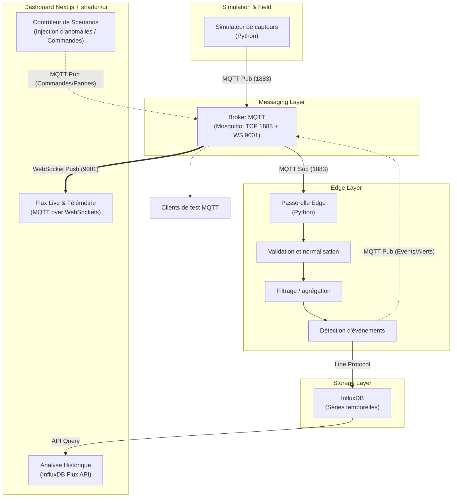
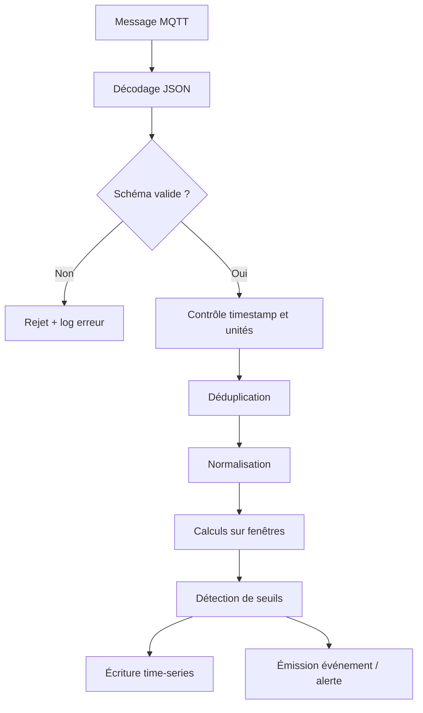

# Pipeline IIoT de bout en bout : capteurs → edge → dashboard temps réel
## Spécifications fonctionnelles, techniques et guide de réalisation

**Projet académique — ENSAM Rabat — Industrie 4.0 — Année 2026–2027**  
**Encadrement : Professeure Maria Zemzami**  
**Version : 1.0 — 6 novembre 2026**

---

## 0. Comment utiliser ce document

Ce document transforme le sujet fourni dans le cahier des charges en une spécification de projet réalisable et évaluable.

- **Exigence du sujet** : élément explicitement demandé dans le document ENSAM.
- **Proposition** : choix d'architecture ou de réalisation recommandé pour obtenir un prototype cohérent.
- **Extension** : fonctionnalité facultative à réaliser après validation du socle.

Le cahier des charges ENSAM demande : contexte et objectifs, périmètre, spécifications fonctionnelles et techniques, cybersécurité, aspects organisationnels et humains, livrables, planning, ressources et critères d'évaluation. Les livrables explicitement cités pour ce sujet sont l'architecture documentée, le simulateur de capteurs, le pipeline de collecte fonctionnel et le dashboard temps réel.

> **Principe directeur :** réaliser un système démontrable de bout en bout, mesurable, reproductible et documenté. Ne pas multiplier les technologies au détriment de la validation expérimentale.

# 1. Résumé exécutif

## 1.1 Sujet

Construire une chaîne IIoT complète qui simule des équipements industriels, collecte leurs mesures, les transporte par un protocole de messagerie adapté à l'IIoT, les traite au niveau Edge, conserve les données et les expose dans un tableau de bord temps réel.

## 1.2 Problématique

Dans une installation industrielle, les données provenant des machines et capteurs sont souvent dispersées entre équipements, automates et systèmes de supervision. Une architecture IIoT doit permettre de remonter ces données de manière fiable, de les traiter au plus près de leur source lorsque cela est pertinent, puis de les rendre exploitables par les opérateurs.

**Question centrale :** comment concevoir et évaluer une architecture IIoT de bout en bout capable de collecter, transporter, traiter localement et visualiser des données industrielles simulées, tout en assurant l'interopérabilité, la résilience et la sécurité de base ?

## 1.3 Objectif général

Concevoir, implémenter et évaluer un prototype IIoT modulaire allant de la génération de mesures industrielles à leur visualisation, avec une passerelle Edge réalisant des traitements locaux avant persistance.

## 1.4 Objectifs spécifiques

1. Simuler plusieurs équipements industriels et des mesures réalistes.
2. Définir un modèle de données commun et une convention de nommage des topics.
3. Transmettre les mesures par MQTT.
4. Recevoir les messages sur une passerelle Edge.
5. Valider, nettoyer, enrichir et agréger les mesures localement.
6. Détecter des conditions anormales par règles simples et explicables.
7. Persister les mesures dans une base time-series.
8. Construire un dashboard temps réel avec filtres par équipement et indicateurs.
9. Tester la latence, le débit, les pertes, la disponibilité et le comportement en cas de panne.
10. Documenter les limites, les choix et les résultats expérimentaux.

# 2. Contexte, périmètre et hypothèses

## 2.1 Contexte Industrie 4.0

L'Industrie 4.0 s'appuie notamment sur la connectivité des équipements, les systèmes cyber-physiques, l'IIoT, l'exploitation des données, l'automatisation et l'intégration entre les niveaux opérationnels et informatiques.

Dans ce projet, l'enjeu principal est la continuité numérique entre les équipements simulés, la communication, le traitement Edge et la supervision.

## 2.2 Périmètre inclus

- Simulation logicielle d'équipements industriels.
- Génération de mesures périodiques et d'événements.
- Communication MQTT entre producteurs et broker.
- Passerelle Edge logicielle.
- Contrôles de qualité des données.
- Agrégation et détection d'anomalies basées sur des règles.
- Persistance des données dans une base time-series.
- Dashboard de supervision.
- Alertes de démonstration.
- Déploiement local reproductible avec Docker Compose.
- Tests fonctionnels, tests de résilience et mesures de performance.
- Documentation et démonstration académique.

## 2.3 Hors périmètre du socle

- Pilotage réel d'une machine industrielle.
- Commandes de contrôle pouvant présenter un risque physique.
- Connexion à un réseau OT de production.
- Certification industrielle ou conformité réglementaire complète.
- Maintenance prédictive fondée sur un modèle ML entraîné sur des données industrielles réelles.
- Haute disponibilité de niveau industriel.
- Déploiement cloud obligatoire.

Toute commande d'actionneur doit rester simulée. Le prototype est un environnement pédagogique isolé, pas un système de contrôle industriel certifié.

## 2.4 Hypothèses initiales à confirmer

| Paramètre | Hypothèse de départ |
|---|---|
| Nombre d'équipements | 5 à 10 équipements simulés |
| Variables par équipement | 4 à 6 |
| Fréquence nominale | 1 message/seconde/équipement |
| Format | JSON UTF-8 |
| Transport | MQTT 5.0, QoS 1 pour les mesures |
| Broker | Eclipse Mosquitto |
| Edge | Service Python |
| Stockage | InfluxDB |
| Visualisation | Custom Dashboard : Next.js 15 (App Router) + shadcn/ui (Tailwind CSS, Lucide, Recharts) |
| Déploiement | Docker Compose |
| Exécution | Ordinateur portable, sans matériel spécialisé |

Ces valeurs sont des paramètres de test, pas des performances garanties. Elles devront être ajustées selon la machine disponible et les résultats mesurés.

# 3. Architecture cible

## 3.1 Vue logique



## 3.2 Composants

### A. Simulateur industriel

Responsabilités :
- représenter plusieurs machines ou postes ;
- générer des valeurs normales et des scénarios de fonctionnement ;
- produire des timestamps et identifiants de séquence ;
- simuler des variations, dérives, arrêts et anomalies ;
- publier les mesures sur MQTT ;
- permettre de configurer le nombre de machines et la fréquence.

### B. Broker MQTT

Responsabilités :
- recevoir les publications des simulateurs ;
- distribuer les messages aux abonnés ;
- appliquer les niveaux QoS ;
- gérer les connexions et sessions ;
- exposer les états de disponibilité des équipements.

Technologie recommandée : Eclipse Mosquitto.

### C. Passerelle Edge

C'est le cœur technique et le principal élément différenciant du projet.

Responsabilités :
- s'abonner aux topics des équipements ;
- vérifier le schéma et les types ;
- détecter les messages invalides ou incomplets ;
- normaliser les unités et les noms de champs ;
- ajouter des métadonnées de réception ;
- calculer des agrégats sur fenêtres temporelles ;
- appliquer des règles d'alerte ;
- transmettre les données traitées vers InfluxDB ;
- journaliser les erreurs ;
- gérer les interruptions temporaires du stockage.

**À démontrer :** le traitement Edge doit réellement modifier ou enrichir le flux. Il ne doit pas être un simple relais MQTT vers la base.

### D. Stockage time-series

Technologie recommandée : InfluxDB OSS.

Conserver :
- mesures brutes ou normalisées selon le choix de conception ;
- mesures agrégées ;
- événements et indicateurs utiles à l'analyse.

Il est conseillé de distinguer les données brutes des données agrégées, par exemple avec deux measurements ou deux buckets selon la version et la configuration retenues.

### E. Dashboard sur-mesure (Next.js + shadcn/ui)

Technologie retenue : Application web Next.js 15 (React 19, TypeScript, Tailwind CSS, composants shadcn/ui, Recharts).

Contrairement à un outil de monitoring passif (ex: Grafana), ce dashboard personnalisé agit comme un véritable **Poste de Conduite et Supervision Industrielle (SCADA moderne)** intégrant :
- **Streaming temps réel sub-100ms** : Connexion directe au broker MQTT via WebSockets (port 9001) pour afficher les jauges, vibrations et statuts sans latence de rafraîchissement ni polling base de données.
- **Analyse historique & KPI** : Interrogation d'InfluxDB via API pour tracer les tendances temporelles, moyennes mobiles et distributions statistiques.
- **Console de pilotage & injection de fautes (Test Lab)** : Interface interactive permettant au jury d'injecter des scénarios anormaux (surchauffe moteur, dérive capteur, trame corrompue, coupure de liaison) et de visualiser immédiatement la réaction de la passerelle Edge et la levée d'alarme.
- **Workflow opérateur** : Acquittement d'alertes en temps réel avec consignation de commentaires de maintenance.

## 3.3 Choix des protocoles

### MQTT comme protocole principal

MQTT est un protocole léger de messagerie publish/subscribe normalisé par OASIS. Il convient au transport de télémétrie IoT/IIoT et permet de travailler sur les garanties de livraison QoS 0, 1 et 2.

- **QoS 0** : livraison au plus une fois ; adaptée aux mesures fréquentes lorsque quelques pertes sont acceptables.
- **QoS 1** : livraison au moins une fois ; possibilité de doublons, donc le consommateur doit être idempotent.
- **QoS 2** : livraison exactement une fois au niveau du protocole MQTT, avec un échange plus coûteux.

**Recommandation :** QoS 1 pour les mesures et déduplication applicative par `device_id + sequence`. QoS 0 peut être testé comme scénario comparatif. QoS 2 est une expérience complémentaire, pas une obligation.

### OPC UA comme extension industrielle

OPC UA est une norme d'interopérabilité industrielle qui couvre notamment les modèles d'information, les services, les alarmes et les mécanismes de sécurité.

Deux options :
1. **Socle :** simuler les capteurs et publier directement en MQTT.
2. **Extension :** simuler un serveur OPC UA, lire des variables via un client OPC UA, puis convertir les données en messages MQTT au niveau de la passerelle.

Ne pas présenter MQTT comme un remplacement universel d'OPC UA, Modbus TCP ou des bus de terrain. Expliquer le rôle de chaque protocole dans l'architecture.

### Sparkplug B comme piste avancée

Eclipse Sparkplug définit un espace de noms de topics, une structure de payload et une gestion d'état pour faciliter l'interopérabilité des applications industrielles sur MQTT. Il peut constituer une extension intéressante après la validation du modèle MQTT JSON initial.

# 4. Spécifications fonctionnelles

Les exigences sont identifiées par des codes pour faciliter leur traçabilité et les tests.

| ID | Exigence | Priorité | Critère de validation |
|---|---|---|---|
| F-01 | Simuler plusieurs équipements | Must | Au moins 5 identifiants distincts |
| F-02 | Générer plusieurs variables industrielles | Must | Température, pression, vibration, état |
| F-03 | Configurer la fréquence d'émission | Must | Fréquence modifiable sans modifier le code |
| F-04 | Simuler des scénarios normaux et anormaux | Must | Scénarios reproductibles |
| F-05 | Publier les mesures via MQTT | Must | Messages visibles avec un client abonné |
| F-06 | Utiliser une convention de topics stable | Must | Topics documentés et testés |
| F-07 | Recevoir les données sur Edge | Must | Consommateur MQTT fonctionnel |
| F-08 | Valider le schéma des messages | Must | Messages invalides rejetés et journalisés |
| F-09 | Normaliser les données | Must | Unités, types et noms cohérents |
| F-10 | Calculer des agrégats Edge | Must | Moyenne/min/max sur fenêtre |
| F-11 | Détecter des seuils anormaux | Must | Événement généré sur dépassement |
| F-12 | Persister les mesures | Must | Données consultables après écriture |
| F-13 | Visualiser les mesures en direct | Must | Jauges et courbes mises à jour par flux WebSocket (latence < 100ms) |
| F-14 | Filtrer par équipement et période | Must | Sélecteur dynamique et requêtes InfluxDB historiques |
| F-15 | Visualiser l'état des équipements | Must | Synoptique avec badges statut en direct (Running, Warning, Stopped) |
| F-16 | Afficher et acquitter les alertes | Must | Console d'alertes avec horodatage, sévérité et action d'acquittement (ACK) |
| F-17 | Injecter des pannes et anomalies | Should | Boutons de commande interactifs dans l'IHM (surchauffe, dérive, paquet invalide) |
| F-18 | Résister à une coupure temporaire | Should | Reconnexion et reprise documentées |
| F-19 | Exporter un échantillon de données | Could | Export CSV / JSON depuis l'interface |
| F-20 | Intégrer OPC UA | Could | Lecture d'un serveur simulé |
| F-21 | Intégrer Sparkplug B | Could | Démonstration de conformité de payload |

## 4.1 Scénarios de simulation

Créer au minimum les scénarios suivants :

1. **Fonctionnement nominal :** signaux stables avec bruit réaliste.
2. **Montée en charge :** augmentation progressive de la température ou de la pression.
3. **Dérive :** variation lente d'une variable.
4. **Pic ponctuel :** valeur anormalement élevée pendant quelques secondes.
5. **Arrêt machine :** état `STOPPED`, puis absence de mesures ou heartbeat dédié.
6. **Déconnexion réseau :** arrêt du broker ou interruption du client.
7. **Données invalides :** valeur manquante, type incorrect, timestamp incohérent.
8. **Retard et doublon :** messages retardés ou répétés pour tester l'idempotence.

Les scénarios doivent être déclenchables par configuration ou commande, avec une graine aléatoire (`seed`) pour reproduire les expériences.

# 5. Modèle de données

## 5.1 Convention de topics MQTT

Proposition :

```text
ensam/iiot/{site_id}/{line_id}/{device_id}/telemetry
ensam/iiot/{site_id}/{line_id}/{device_id}/status
ensam/iiot/{site_id}/{line_id}/{device_id}/event
ensam/iiot/{site_id}/{line_id}/{device_id}/command
```

Exemples :

```text
ensam/iiot/site-a/line-1/motor-01/telemetry
ensam/iiot/site-a/line-1/motor-01/status
ensam/iiot/site-a/line-1/motor-01/event
```

Le topic `command` peut être réservé à une extension de simulation. Aucun actionneur réel ne doit être piloté.

## 5.2 Payload JSON recommandé

```json
{
  "schema_version": "1.0",
  "message_id": "motor-01-00001234",
  "device_id": "motor-01",
  "site_id": "site-a",
  "line_id": "line-1",
  "sequence": 1234,
  "timestamp": "2026-11-06T14:30:00.125Z",
  "measurements": {
    "temperature_c": 68.4,
    "pressure_bar": 5.2,
    "vibration_mm_s": 2.8,
    "humidity_pct": 42.1
  },
  "machine_state": "RUNNING",
  "quality": "GOOD"
}
```

Règles :
- timestamps ISO 8601 UTC ;
- identifiant de message unique ;
- numéro de séquence croissant par équipement ;
- unités explicites dans les noms ou métadonnées ;
- version de schéma ;
- valeurs numériques finies ;
- valeurs manquantes gérées explicitement ;
- état machine issu d'un ensemble documenté.

## 5.3 Métadonnées ajoutées par Edge

Le traitement Edge peut ajouter :
- `edge_received_at` ;
- `processing_latency_ms` ;
- `validation_status` ;
- `anomaly_flag` ;
- `anomaly_reason` ;
- `aggregation_window` ;
- `source_topic`.

Conserver le timestamp de mesure original et ne pas le remplacer par le timestamp de réception.

# 6. Traitements Edge

## 6.1 Pipeline logique



## 6.2 Validation

Vérifier :
- présence des champs obligatoires ;
- types corrects ;
- `device_id` autorisé ;
- timestamp analysable ;
- valeurs numériques finies ;
- plages physiques plausibles définies pour le scénario ;
- séquence et identifiant cohérents.

Ne pas confondre une valeur hors plage avec une donnée techniquement invalide : une température très élevée peut être une mesure valide et précisément le signal d'une anomalie.

## 6.3 Déduplication et idempotence

Avec QoS 1, un message peut être reçu plus d'une fois. Construire une clé idempotente, par exemple :

```text
(device_id, sequence)
```

Mémoriser les séquences récemment traitées ou utiliser une stratégie d'écriture garantissant que le même point ne soit pas comptabilisé deux fois dans les KPI. Documenter la durée de conservation du cache de déduplication.

## 6.4 Agrégation

Pour chaque équipement et fenêtre de 10 secondes, calculer :
- moyenne ;
- minimum ;
- maximum ;
- nombre de mesures ;
- écart-type facultatif.

Comparer les données brutes et agrégées. L'agrégation réduit le volume transmis vers le stockage, mais peut masquer des pics brefs : conserver les événements importants et préciser la stratégie.

## 6.5 Détection d'anomalies

Socle obligatoire : règles explicables.

Exemples de règles :
- température supérieure au seuil configuré ;
- vibration supérieure au seuil ;
- pression hors intervalle ;
- absence de heartbeat au-delà d'un délai ;
- variation trop rapide entre deux mesures.

Chaque alerte doit contenir :
- identifiant de l'équipement ;
- variable concernée ;
- valeur observée ;
- seuil ;
- timestamp ;
- sévérité ;
- raison textuelle.

Extension facultative : Isolation Forest ou autre modèle non supervisé, uniquement après création d'une baseline et définition d'une méthode d'évaluation. Ne pas annoncer une « maintenance prédictive » sur la seule base d'un dépassement de seuil.

## 6.6 Buffer local et résilience

Version minimale :
- reconnexion automatique au broker ;
- reconnexion à InfluxDB ;
- journalisation des erreurs ;
- métriques sur les messages en échec.

Extension recommandée :
- file locale persistante (SQLite ou fichiers append-only) ;
- reprise de l'envoi après retour du stockage ;
- politique de rétention du buffer ;
- gestion des doublons lors du rejeu.

Tester une panne réelle en arrêtant temporairement le service cible, puis vérifier ce qui est perdu, conservé et rejoué.

# 7. Spécifications techniques

## 7.1 Stack recommandée

| Couche | Technologie | Rôle |
|---|---|---|
| Langage backend | Python 3.11+ | Simulateur d'équipements et Passerelle Edge |
| MQTT client backend | Eclipse Paho MQTT | Publication / abonnement télémétrie et commandes |
| Broker MQTT | Eclipse Mosquitto (v2.x) | Routage MQTT (Port TCP 1883 + WebSockets 9001) |
| Validation de données | Pydantic v2 | Validation des schémas, typage et sanitisation |
| Stockage time-series | InfluxDB OSS (v2.x) | Persistance historique, agrégations et requêtes Flux |
| Dashboard Frontend | Next.js 15 (App Router), React 19, TypeScript | IHM de supervision SCADA, streaming live et contrôle |
| UI & Visualisation | shadcn/ui, Tailwind CSS, Lucide Icons, Recharts | Design system moderne dark-mode, jauges et graphiques |
| Client MQTT Frontend | MQTT.js (via WebSockets) | Abonnement direct du navigateur aux topics Mosquitto |
| Conteneurs & Orchestration | Docker + Docker Compose | Déploiement reproductible de l'ensemble de la pile |
| Tests & Qualité | pytest, Ruff, logging structuré | Validation unitaire, intégration et résilience |
| Versionnement | Git | Historique, traçabilité et collaboration |

Ne pas ajouter Kafka, Spark, Kubernetes ou un cloud public au socle. Ils augmenteraient la complexité sans être nécessaires à l'objectif du sujet.

## 7.2 Exigences non fonctionnelles proposées

Les valeurs ci-dessous sont des **objectifs expérimentaux initiaux** à valider sur la machine de test.

| ID | Indicateur | Cible initiale |
|---|---|---|
| NF-01 | Latence Edge (réception → traitement) | p95 < 100 ms en charge nominale |
| NF-02 | Latence de bout en bout (publication → affichage/stockage) | Mesurée, cible p95 < 2 s |
| NF-03 | Débit nominal | 10 messages/s minimum |
| NF-04 | Intégrité | 100 % des messages acceptés conformes au schéma |
| NF-05 | Résilience | Reconnexion automatique après coupure simulée |
| NF-06 | Traçabilité | Logs horodatés et identifiants corrélables |
| NF-07 | Reproductibilité | Démarrage documenté en une commande principale |
| NF-08 | Persistance | Données conservées après redémarrage des conteneurs |

Préciser l'environnement de mesure : CPU, RAM, OS, versions des composants, nombre d'équipements, fréquence et durée du test.

## 7.3 Cybersécurité

S'appuyer sur NIST SP 800-82 Rev. 3, guide de sécurité des systèmes OT. Il couvre les contraintes de performance, fiabilité et sûreté propres à l'OT, ainsi que les topologies, menaces et contre-mesures.

Mesures minimales :
- ne pas exposer le broker publiquement ;
- désactiver l'accès anonyme ;
- créer des comptes distincts pour producteurs et consommateurs ;
- appliquer des ACL par topic ;
- séparer les réseaux Docker lorsque pertinent ;
- ne publier que les ports nécessaires ;
- utiliser TLS dans une démonstration avancée ;
- ne jamais committer de secrets ou tokens ;
- conserver les images et dépendances à jour ;
- journaliser les connexions et erreurs ;
- documenter les flux réseau autorisés.

**Attention :** ce prototype ne doit jamais être connecté directement à un réseau OT de production. Toute expérimentation de sécurité reste confinée à l'environnement de laboratoire.

## 7.4 Disponibilité et exploitation

- Healthcheck des services lorsque possible.
- Volumes persistants pour les données.
- Redémarrage contrôlé des services.
- Logs exploitables.
- Procédure de sauvegarde et restauration.
- Procédure de réinitialisation du laboratoire.
- Fichier `.env.example` sans secrets réels.

# 8. Dashboard sur-mesure (Next.js + shadcn/ui) : exigences de conception

L'IHM de supervision est conçue comme un **Poste de Conduite Industriel Moderne (SCADA / Operations Center)** développé en Next.js 15 avec le design system **shadcn/ui** (Tailwind CSS, icônes Lucide, graphiques Recharts). L'interface arbore une esthétique industrielle sobre et professionnelle en mode sombre (Dark Mode) avec typographie technique et badges d'état haute visibilité.

## 8.1 Architecture technique de l'IHM

L'application s'appuie sur une double architecture temps réel / historique :
1. **Couche Streaming Direct (MQTT over WebSockets)** : Le navigateur se connecte directement au port `9001` de Mosquitto via la bibliothèque `mqtt.js`. Il s'abonne aux topics `ensam/iiot/+/+/+/telemetry`, `.../status` et `.../event`. Les métriques (température, pression, vibration, statut) sont injectées dans l'état React sans latence de rafraîchissement (< 100 ms) et sans surcharger la base de données.
2. **Couche Historique (API Routes Next.js / Server Actions $\rightarrow$ InfluxDB)** : Interrogation de la base InfluxDB pour récupérer les séries agrégées (1h, 6h, 24h), calculer les tendances et tracer les graphiques historiques.
3. **Couche Commande & Injection (MQTT Publisher côté client/serveur)** : Envoi de messages de consigne ou d'injection de pannes sur le topic `ensam/iiot/{site}/{line}/{device}/command` pour piloter le simulateur à la volée.

## 8.2 Vue 1 — Synoptique d'Usine & KPI Globaux (Plant Overview)

Cette vue offre une vue d'ensemble instantanée de l'état du parc industriel :
- **Bandeau de KPIs généraux** :
  - Nombre total d'équipements actifs / total configuré.
  - Taux de disponibilité opérationnelle globale (%).
  - Débit total de télémétrie reçue (msg/s).
  - Nombre d'alertes actives non acquittées (badges critiques clignotants).
  - Latence moyenne observée de la passerelle Edge (ms).
- **Grille des équipements (Machine Cards)** :
  - Chaque carte affiche le nom du composant (`motor-01`, `pump-02`, etc.), son site et sa ligne.
  - Statut visuel avec badge de couleur : `RUNNING` (vert émeraude), `WARNING` (orange ambre), `CRITICAL` (rouge rubis), `STOPPED` (gris ardoise).
  - Mini-jauges en direct des 4 grandeurs clés (température, pression, vibration, humidité).
  - Horodatage de la dernière trame reçue avec indicateur de pulsation temps réel.

## 8.3 Vue 2 — Télémétrie Détaillée Équipement (Digital Twin View)

Permet de zoomer sur un équipement sélectionné pour une analyse approfondie :
- **Sélecteur d'équipement et de plage temporelle** (Temps réel, 15 min, 1h, 24h).
- **Jauges radiales interactives** pour chaque grandeur physique, affichant la valeur actuelle, les seuils mini/maxi admissibles et les zones de danger colorées.
- **Courbes temporelles multi-axes (Recharts)** :
  - Affichage simultané des mesures brutes temps réel et des courbes moyennes calculées par l'Edge.
  - Lignes de seuils horizontales visibles pour comprendre immédiatement la zone d'alerte.
- **Panneau d'état et métadonnées** : identifiant matériel, version du firmware simulé, compteur de séquence, statut de la connexion MQTT (QoS utilisé, session).

## 8.4 Vue 3 — Console d'Alertes & Workflow Opérateur (Incident Response)

Implémentation concrète des aspects humains et organisationnels attendus dans le cahier des charges :
- **Flux d'alertes en direct** alimenté par les événements publiés par l'Edge.
- **Tableau de bord filtrable** par niveau de sévérité (`INFO`, `WARNING`, `CRITICAL`), par équipement et par date.
- **Workflow d'acquittement (ACK)** :
  - Un opérateur peut cliquer sur « Acquitter » pour marquer l'alerte comme prise en charge.
  - Champ de saisie pour ajouter une note de diagnostic (ex: « Vérification du palier demandée au technicien »).
  - Historisation complète des acquittements pour la traçabilité.

## 8.5 Vue 4 — Centre de Pilotage & Injection d'Anomalies (Interactive Test Lab)

**Composant majeur pour la soutenance devant le jury de l'ENSAM :**
Cette interface permet à l'évaluateur ou à l'étudiant d'interagir directement avec le simulateur sans toucher à la console ou au code :
- **Sélecteur de cible** : Choisir une machine spécifique (ex: `motor-01`).
- **Boutons d'injection de scénarios prédéfinis** :
  - *🔥 Surchauffe thermique* : Déclenche une montée progressive de la température au-delà de 85 °C.
  - *⚡ Pic de vibration soudain* : Simule un balourd mécanique temporaire (> 4.5 mm/s).
  - *📉 Dérive de pression* : Simule une fuite ou une baisse graduelle du circuit.
  - *🛑 Arrêt d'urgence* : Force l'état `STOPPED` et l'interruption des mesures.
  - *⚠️ Trame corrompue* : Envoie délibérément une charge utile avec types invalides ou champs manquants pour prouver le rejet par la passerelle Edge.
  - *🔌 Coupure réseau simulée* : Interrompt les publications de la machine pour tester la détection de silence (heartbeat timeout).
- **Visualisation de l'effet en direct** : L'IHM montre simultanément l'ordre envoyé, la réponse du simulateur, l'analyse par l'Edge et la génération immédiate de l'alerte dans la console.

## 8.6 Vue 5 — Métriques Pipeline & Edge Health (Performance & Diagnostics)

Permet de vérifier la conformité aux exigences non-fonctionnelles :
- Débit d'ingestion (messages reçus / seconde).
- Distribution de la latence Edge (p50, p90, p95).
- Taux de conformité des schémas (messages validés vs messages rejetés).
- Taux de déduplication (doublons QoS 1 filtrés avec succès).
- Indicateurs de santé des conteneurs (Mosquitto, Edge Gateway, InfluxDB).

# 9. Guide de réalisation étape par étape

## Phase 0 — Cadrage et préparation

**Objectif :** figer le périmètre et préparer l'environnement.

Tâches :
1. Lire et reformuler le cahier des charges.
2. Valider les hypothèses avec l'encadrante.
3. Choisir les variables industrielles.
4. Définir les équipements simulés.
5. Définir les scénarios normaux et anormaux.
6. Dessiner l'architecture.
7. Créer le dépôt Git et les conventions de développement.

Livrables :
- note de cadrage ;
- diagramme d'architecture ;
- tableau des exigences ;
- backlog initial.

Critère de sortie : chaque exigence Must possède une méthode de vérification.

## Phase 1 — Modèle de données et simulateur

**Objectif :** produire un flux de données cohérent avant de construire l'infrastructure complète.

Tâches :
1. Définir le schéma JSON versionné.
2. Définir les plages et unités des variables.
3. Implémenter une classe ou un module par type de machine.
4. Ajouter les scénarios configurables.
5. Ajouter timestamps UTC, séquences et message IDs.
6. Ajouter la reproductibilité via une seed.
7. Exporter quelques mesures en JSONL pour inspection.

Tests :
- types et champs ;
- monotonie des séquences ;
- fréquence d'émission ;
- reproductibilité ;
- scénarios anormaux.

Critère de sortie : le simulateur génère un jeu de données documenté et reproductible.

## Phase 2 — Broker et communication MQTT

**Objectif :** faire communiquer les producteurs et les consommateurs.

Tâches :
1. Déployer Mosquitto.
2. Configurer le broker.
3. Créer les comptes et ACL.
4. Définir les topics.
5. Implémenter le publisher Paho.
6. Implémenter un subscriber de diagnostic.
7. Tester QoS 0 et QoS 1.
8. Tester retained messages pour l'état si pertinent.
9. Tester la reconnexion d'un client.

Commandes de diagnostic possibles :

```bash
mosquitto_sub -h localhost -t 'ensam/iiot/#' -v
```

Publier un message de test :

```bash
mosquitto_pub -h localhost \
  -t 'ensam/iiot/site-a/line-1/motor-01/telemetry' \
  -m '{"device_id":"motor-01","temperature_c":42.0}'
```

Ces commandes supposent un broker local accessible sans authentification, uniquement pour un test initial isolé. En configuration sécurisée, ajouter les paramètres d'identification et ne pas autoriser l'anonymat.

Critère de sortie : plusieurs producteurs publient et un consommateur reçoit les messages sur les bons topics.

## Phase 3 — Développement du Edge Gateway

**Objectif :** développer le traitement local et prouver sa valeur.

Tâches :
1. S'abonner aux topics telemetry.
2. Décoder et valider le JSON.
3. Rejeter et journaliser les messages invalides.
4. Dédupliquer par équipement et séquence.
5. Normaliser les données.
6. Ajouter les métadonnées Edge.
7. Calculer les agrégats temporels.
8. Appliquer les règles d'anomalie.
9. Gérer les exceptions et reconnexions.
10. Écrire des tests unitaires pour chaque traitement.

Critère de sortie : un message brut peut être suivi à travers les étapes Edge jusqu'à sa sortie normalisée.

## Phase 4 — Stockage time-series

**Objectif :** persister les mesures et rendre possible l'analyse historique.

Tâches :
1. Déployer InfluxDB.
2. Créer organisation, bucket et token.
3. Définir measurements, tags et fields.
4. Écrire depuis le Edge.
5. Vérifier timestamps et précision.
6. Tester requêtes temporelles.
7. Vérifier persistance après redémarrage.

Éviter de mettre des identifiants à forte cardinalité (par exemple `message_id`) en tags. Les tags doivent rester des dimensions de filtrage relativement stables.

Critère de sortie : les mesures sont consultables et les données restent présentes après redémarrage.

## Phase 5 — Dashboard sur-mesure (Next.js + shadcn/ui)

**Objectif :** rendre les données exploitables, offrir une supervision temps réel sub-100ms et fournir un laboratoire interactif d'injection de pannes pour la soutenance.

Tâches :
1. Initialiser le projet Next.js 15 (TypeScript, Tailwind CSS, shadcn/ui).
2. Mettre en place le client MQTT WebSocket (`mqtt.js`) connecté au port 9001 de Mosquitto.
3. Implémenter les routes API / Server Actions pour interroger InfluxDB v2 (requêtes historiques).
4. Développer le synoptique d'usine (Vue 1) avec jauges en direct et cartes machines.
5. Développer la vue détaillée par équipement (Vue 2) avec graphiques multi-axes Recharts.
6. Développer la console d'alertes temps réel avec système d'acquittement (Vue 3).
7. Développer le centre de pilotage interactif (Vue 4) permettant au jury d'injecter des scénarios (surchauffe, dérive, paquet invalide, déconnexion).
8. Conteneuriser le dashboard avec Dockerfile multi-stage et l'intégrer au `docker-compose.yml`.

Critère de sortie : l'interface se connecte en direct à Mosquitto, affiche les mesures à jour sans latence de rechargement, permet de requêter l'historique InfluxDB et réagit immédiatement aux anomalies injectées.

## Phase 6 — Résilience, cybersécurité et optimisation

Tâches :
1. Tester arrêt/redémarrage du broker.
2. Tester indisponibilité temporaire d'InfluxDB.
3. Tester messages invalides et doublons.
4. Tester montée en charge.
5. Configurer authentification et ACL.
6. Vérifier les ports exposés.
7. Ajouter buffer persistant si le temps le permet.
8. Documenter les risques et limites.

Critère de sortie : les comportements en panne sont observés, mesurés et expliqués.

## Phase 7 — Évaluation et rapport

Tâches :
1. Définir les scénarios de benchmark.
2. Exécuter plusieurs répétitions.
3. Collecter latences et débits.
4. Comparer les QoS.
5. Comparer traitement brut et agrégé si possible.
6. Analyser les pertes et doublons.
7. Présenter les résultats sous forme de tableaux et graphiques.
8. Documenter les limites et pistes futures.

Critère de sortie : chaque conclusion quantitative est associée à une expérience reproductible.

# 10. Protocole expérimental et évaluation académique

Un projet académique doit démontrer non seulement que le système fonctionne, mais aussi dans quelles conditions et avec quelles limites.

## 10.1 Questions expérimentales

- Quel est le débit maximal soutenu par le prototype ?
- Comment la latence évolue-t-elle lorsque le nombre d'équipements augmente ?
- Quelle différence observe-t-on entre QoS 0 et QoS 1 ?
- Quel est l'effet de l'agrégation Edge sur le volume de données stockées ?
- Que se passe-t-il lors d'une interruption du broker ?
- Que se passe-t-il lorsque le stockage devient indisponible ?
- Quelle proportion de messages invalides ou dupliqués est détectée ?

## 10.2 Matrice de tests

| Test | Variables | Mesures |
|---|---|---|
| T1 — Fonctionnement nominal | 5 devices, 1 msg/s | Débit, latence, intégrité |
| T2 — Montée en charge | 5, 10, 25, 50 devices | CPU, RAM, débit, p95 |
| T3 — Fréquence | 1, 5, 10 msg/s/device | Débit et latence |
| T4 — QoS | 0 et 1 | Pertes, doublons, latence |
| T5 — Messages invalides | 1 %, 5 %, 10 % | Taux de rejet |
| T6 — Panne broker | Arrêt temporaire | Perte, reconnexion, reprise |
| T7 — Panne stockage | InfluxDB indisponible | Erreurs, buffer, rejeu |
| T8 — Agrégation | Brutes vs fenêtres | Volume et préservation des pics |

Ne pas annoncer de résultat avant exécution. Répéter les tests, fixer les paramètres et conserver les logs bruts.

## 10.3 Métriques à calculer

- **Débit :** nombre de messages traités par seconde.
- **Latence Edge :** `edge_processed_at - edge_received_at`.
- **Latence de bout en bout :** `dashboard_or_storage_time - source_timestamp`, en tenant compte de la synchronisation des horloges.
- **Taux de perte estimé :** `(messages émis - messages reçus uniques) / messages émis`.
- **Taux de doublons :** `messages dupliqués / messages reçus`.
- **Taux de rejet :** `messages invalides / messages reçus`.
- **Réduction du volume :** comparer le nombre de points avant et après agrégation.
- **Ressources :** CPU et mémoire des conteneurs.

Rapporter au minimum moyenne, médiane, p95, maximum et nombre d'échantillons pour les mesures de latence.

## 10.4 Comparaison Edge vs traitement centralisé

Expérience intéressante :
- mode A : envoyer les mesures brutes au stockage et calculer les indicateurs après ingestion ;
- mode B : agréger et filtrer à l'Edge avant stockage.

Comparer :
- volume de données ;
- charge réseau ;
- latence ;
- capacité à conserver les événements transitoires ;
- charge CPU sur Edge.

La comparaison doit conserver les mêmes scénarios et paramètres.

# 11. Organisation du code et dépôt Git

## 11.1 Arborescence proposée

```text
ensam-iiot-pipeline/
├── README.md
├── docs/
│   ├── cahier_des_charges.md
│   ├── architecture.md
│   ├── data_model.md
│   ├── security.md
│   ├── experiments.md
│   └── images/
├── simulator/
│   ├── src/
│   │   ├── devices/
│   │   ├── scenarios/
│   │   ├── mqtt_publisher.py
│   │   └── main.py
│   └── tests/
├── edge/
│   ├── src/
│   │   ├── mqtt_consumer.py
│   │   ├── validation.py
│   │   ├── normalization.py
│   │   ├── deduplication.py
│   │   ├── aggregation.py
│   │   ├── anomaly_rules.py
│   │   ├── storage.py
│   │   └── main.py
│   └── tests/
├── dashboard/
│   ├── src/
│   │   ├── app/
│   │   │   ├── layout.tsx
│   │   │   ├── page.tsx
│   │   │   ├── devices/
│   │   │   ├── alerts/
│   │   │   ├── control-lab/
│   │   │   └── api/
│   │   ├── components/
│   │   │   ├── ui/
│   │   │   ├── telemetry-charts.tsx
│   │   │   ├── machine-card.tsx
│   │   │   ├── alert-console.tsx
│   │   │   └── fault-injector.tsx
│   │   ├── hooks/
│   │   │   └── useMqttStream.ts
│   │   └── lib/
│   │       ├── influx-client.ts
│   │       └── mqtt-config.ts
│   ├── package.json
│   ├── Dockerfile
│   └── tsconfig.json
├── infrastructure/
│   ├── mosquitto/
│   │   ├── config/
│   │   │   └── mosquitto.conf
│   │   └── acl/
│   └── influxdb/
├── tests/
│   ├── integration/
│   ├── resilience/
│   └── performance/
├── scripts/
│   ├── generate_test_data.py
│   └── run_benchmark.py
├── docker-compose.yml
├── .env.example
├── .gitignore
└── requirements/
```

## 11.2 Principes de développement

- Séparer simulation, communication, logique Edge et stockage.
- Centraliser les paramètres dans des fichiers de configuration.
- Utiliser des logs structurés.
- Écrire des tests unitaires avant les tests d'intégration.
- Versionner les schémas et dashboards.
- Épingler les versions des images Docker pour la reproductibilité.
- Ne jamais versionner `.env`, tokens ou mots de passe.
- Documenter toute décision d'architecture importante.

## 11.3 Conventions Git

Exemples de commits :
- `feat(simulator): add motor telemetry generator`
- `feat(mqtt): implement telemetry publisher`
- `feat(edge): validate incoming payloads`
- `feat(edge): add rolling aggregation`
- `feat(storage): persist normalized telemetry`
- `feat(dashboard): add equipment overview`
- `test(resilience): simulate broker outage`
- `docs: document benchmark methodology`

# 12. Livrables attendus

## 12.1 Livrables explicitement demandés par le sujet

1. **Architecture documentée** : diagrammes, composants, flux, protocoles, choix techniques.
2. **Simulateur de capteurs** : code, configuration, scénarios et données de démonstration.
3. **Pipeline de collecte fonctionnel** : broker, clients, Edge, validation et stockage.
4. **Dashboard temps réel** : vues synthétiques et détaillées.

## 12.2 Livrables complémentaires recommandés

5. Cahier des charges détaillé et matrice de traçabilité.
6. Code source versionné.
7. Fichiers Docker Compose et configurations.
8. Tests unitaires et d'intégration.
9. Rapport expérimental avec résultats mesurés.
10. Guide d'installation et d'exploitation.
11. Manuel utilisateur du dashboard.
12. Présentation et scénario de démonstration.

# 13. Aspects organisationnels et humains

Même pour un prototype, décrire les utilisateurs et les changements de processus.

## 13.1 Parties prenantes

- **Opérateur :** consulte les états, mesures et alertes.
- **Technicien de maintenance :** examine les tendances et événements.
- **Administrateur :** gère services, comptes, sauvegardes et disponibilité.
- **Équipe projet :** développe, teste et documente.

## 13.2 Parcours opérateur

1. Ouvrir le dashboard.
2. Vérifier l'état global des équipements.
3. Sélectionner une machine.
4. Examiner les tendances.
5. Identifier une alerte et sa cause.
6. Consulter l'historique.
7. Signaler l'événement selon la procédure simulée.

## 13.3 Formation et accompagnement

Prévoir une courte prise en main :
- lecture des indicateurs ;
- interprétation des seuils ;
- distinction entre donnée invalide et anomalie procédé ;
- consultation de l'historique ;
- procédure en cas de perte de communication.

# 14. Planning prévisionnel

Planning indicatif sur 8 semaines, à adapter au calendrier réel du module.

| Semaine | Activités | Résultat attendu |
|---|---|---|
| 1 | Cadrage, recherche bibliographique, architecture | Cahier des charges validé |
| 2 | Modèle de données et simulateur | Flux JSON reproductible |
| 3 | Broker MQTT, topics et tests QoS | Communication fonctionnelle |
| 4 | Edge : validation, normalisation, règles | Traitement local opérationnel |
| 5 | InfluxDB et persistance | Historisation fonctionnelle |
| 6 | Dashboard Next.js + shadcn/ui & alertes | IHM temps réel & pilotage |
| 7 | Sécurité, résilience, benchmarks | Résultats expérimentaux |
| 8 | Rapport, documentation, démonstration | Livraison finale |

**Jalons :**
- J1 : architecture et modèle validés ;
- J2 : première télémétrie reçue ;
- J3 : traitement Edge démontré ;
- J4 : données historisées ;
- J5 : dashboard temps réel et centre d'injection de pannes opérationnels ;
- J6 : campagne de tests terminée ;
- J7 : soutenance prête.

# 15. Ressources nécessaires

## 15.1 Matériel

Socle :
- ordinateur avec virtualisation et Docker ;
- connexion réseau locale ;
- aucun capteur physique obligatoire.

Optionnel :
- Raspberry Pi ou mini-PC pour représenter un vrai nœud Edge ;
- ESP32 et capteur de température ;
- capteur de vibration adapté à une démonstration ;
- réseau local isolé.

Le matériel réel est une extension, pas une condition de réussite du sujet.

## 15.2 Logiciels

- Python 3.11+ ;
- Node.js 20+ et npm/pnpm ;
- Framework Next.js 15, React 19, Tailwind CSS, shadcn/ui ;
- Docker Engine / Docker Desktop et Docker Compose ;
- Eclipse Mosquitto (avec support WebSockets) ;
- InfluxDB OSS v2.x ;
- Git ;
- éditeur de code (VS Code / Antigravity) ;
- client MQTT de diagnostic (MQTT Explorer ou mosquitto-clients).

## 15.3 Budget

Le prototype peut être réalisé avec des logiciels open source et un ordinateur existant. Les coûts matériels dépendent des extensions retenues. Aucun budget matériel n'est nécessaire pour valider le socle simulé.

# 16. Critères d'évaluation et traçabilité

| Domaine | Critère | Preuve |
|---|---|---|
| Fonctionnel | Simulation multi-équipements | Démonstration et logs |
| Communication | MQTT opérationnel (TCP + WebSockets) | Topics et captures de messages |
| Edge | Traitement réel des mesures | Tests et comparaison entrée/sortie |
| Stockage | Historisation | Requêtes et données persistées |
| Dashboard | Supervision exploitable & pilotage | Démonstration du Dashboard Next.js / shadcn |
| Sécurité | Authentification et ACL | Configuration et tests d'accès |
| Résilience | Reconnexion et gestion de panne | Rapport de tests |
| Performance | Latence et débit | Résultats reproductibles |
| Documentation | Installation et architecture | Dépôt et rapport |
| Organisation | Planning et responsabilités | Suivi de projet |

### Proposition de pondération pour l'auto-évaluation

Cette pondération est une proposition de gestion de projet, pas un barème officiel de l'ENSAM.

- Fonctionnalités et intégration : 30 %
- Qualité de l'architecture et du code : 20 %
- Évaluation expérimentale : 20 %
- Sécurité et résilience : 10 %
- Documentation et reproductibilité : 10 %
- Démonstration et ergonomie : 10 %

# 17. Risques et mesures de mitigation

| Risque | Impact | Mitigation |
|---|---|---|
| Périmètre trop ambitieux | Retard | Livrer d'abord le socle MQTT |
| Trop de technologies | Complexité | Pas de Kafka/Spark/Kubernetes au départ |
| Données peu réalistes | Résultats faibles | Scénarios et distributions documentés |
| Doublons MQTT QoS 1 | KPI erronés | Idempotence et déduplication |
| Perte pendant une panne | Données manquantes | Buffer local en extension |
| Mauvaise cardinalité InfluxDB | Stockage inefficace | Tags stables, IDs en fields |
| Dashboard surchargé | Faible utilisabilité | Vue synthétique puis détail |
| Résultats non reproductibles | Faible valeur académique | Seeds, versions, scripts de benchmark |
| Exposition réseau involontaire | Risque sécurité | Réseau isolé, ACL, ports minimaux |

# 18. Scénario de démonstration finale

Durée indicative : 7 à 10 minutes.

1. Présenter l'architecture et le flux de données.
2. Démarrer l'ensemble avec Docker Compose.
3. Lancer cinq équipements simulés.
4. Montrer les publications MQTT et les topics.
5. Montrer la passerelle Edge qui valide et enrichit les mesures.
6. Déclencher une anomalie (ex: surchauffe ou pic de vibration) directement depuis le panneau « Test Lab » du Dashboard Next.js.
7. Observer la réaction instantanée dans le dashboard : mise à jour des jauges, levée de l'alerte critique et acquittement par l'opérateur.
8. Arrêter temporairement un service pour montrer le comportement de résilience.
9. Présenter les résultats de latence et de débit.
10. Conclure sur les limites et extensions.

La démonstration doit être préparée avec un scénario déterministe afin d'éviter de dépendre du hasard.

# 19. Extensions possibles — après validation du socle

Par ordre de valeur pédagogique :

1. **OPC UA :** serveur simulé et client de collecte vers MQTT.
2. **Sparkplug B :** modèle de topics et payload industriel standardisé.
3. **Edge buffering :** file locale persistante et rejeu.
4. **Machine Learning :** détection non supervisée sur des données simulées, avec évaluation rigoureuse.
5. **Matériel physique :** ESP32/Raspberry Pi et capteur réel.
6. **Comparaison cloud/edge :** mesurer latence, volume et disponibilité.
7. **Sécurité renforcée :** TLS, certificats, rotation des identifiants et segmentation.

Ne commencer une extension que lorsque tous les critères Must sont validés.

# 20. Ressources bibliographiques et techniques

Les ressources ci-dessous sont les références de départ. Les standards doivent être cités dans le rapport avec leur version et leur date de consultation. Les documentations logicielles évoluent : épingler les versions utilisées dans le dépôt.

## 20.1 Standards et architecture industrielle

1. **OASIS — MQTT Version 5.0, Standard.**  
   https://docs.oasis-open.org/mqtt/mqtt/v5.0/mqtt-v5.0.html  
   Référence principale pour le fonctionnement MQTT, QoS, sessions, retained messages et sécurité.

2. **OASIS — MQTT Standard overview.**  
   https://www.oasis-open.org/standard/mqtt-v5-0-cs02/  
   Présentation du standard et de son contexte IoT/M2M.

3. **OPC Foundation — OPC UA documents.**  
   https://profiles.opcfoundation.org/document/  
   Référence pour les parties de la spécification OPC UA, notamment concepts, sécurité, services, modèle d'information et PubSub.

4. **Eclipse Foundation — Sparkplug Specification.**  
   https://sparkplug.eclipse.org/specification/  
   Spécification pour l'interopérabilité des applications industrielles utilisant MQTT.

5. **NIST — SP 800-82 Rev. 3, Guide to Operational Technology Security (2023).**  
   https://csrc.nist.gov/pubs/sp/800/82/r3/final  
   Référence majeure pour les architectures OT, segmentation, risques et contre-mesures. Une première ébauche de la révision 4 a été annoncée en septembre 2026 ; utiliser la Rev. 3 comme publication finale disponible et vérifier le statut de la Rev. 4 avant la rédaction finale.

## 20.2 Communication MQTT

6. **Eclipse Mosquitto — Documentation.**  
   https://mosquitto.org/documentation/  
   Installation, configuration, utilisateurs, ACL, WebSockets et outils de diagnostic.

7. **Eclipse Paho — Python MQTT Client.**  
   https://eclipse.dev/paho/clients/python/docs/  
   Publication, abonnement, callbacks, QoS et reconnexion.

## 20.3 Stockage et visualisation

8. **InfluxDB — Write data / Line Protocol.**  
   https://docs.influxdata.com/influxdb/v2/get-started/write/  
   Modèle de données et ingestion time-series.

9. **InfluxDB — Line Protocol reference.**  
   https://docs.influxdata.com/influxdb/v2/reference/syntax/line-protocol/  
   Syntaxe des measurements, tags, fields et timestamps.

10. **Next.js & shadcn/ui — Modern SCADA Interface.**  
    https://nextjs.org/docs & https://ui.shadcn.com/  
    Architecture React Server Components, streaming WebSocket client et design system industriel.

## 20.4 Déploiement reproductible

11. **Docker — Compose file reference.**  
    https://docs.docker.com/reference/compose-file/  
    Services, réseaux, volumes et configuration.

12. **Docker — Compose services.**  
    https://docs.docker.com/reference/compose-file/services/  
    Définition des services et healthchecks.

## 20.5 Implémentations et exemples à étudier

13. **Eclipse Sparkplug.**  
    https://sparkplug.eclipse.org/  
    Étudier le modèle Edge of Network, le namespace de topics et le cycle de vie des états.

14. **Eclipse Milo — OPC UA implementation.**  
    https://github.com/eclipse-milo/milo  
    Implémentation open source OPC UA en Java ; utile pour comprendre le modèle client/serveur et réaliser une extension OPC UA.

15. **Eclipse Milo — Client guide.**  
    https://github.com/eclipse-milo/milo/wiki/Client  
    Exemple de création d'un client et de lecture/abonnement aux variables OPC UA.

Ces projets et documentations sont des références d'implémentation et des exemples de conception ; ils ne constituent pas une validation expérimentale de notre propre système.

# 21. Questions validées et arbitrages techniques

1. **Protocole de base** : MQTT 5.0 retenu pour le socle (avec QoS 1 et déduplication), OPC UA positionné comme extension d'interopérabilité.
2. **Environnement** : Entièrement conteneurisé et simulé pour garantir une reproductibilité parfaite sur toute machine de test.
3. **Supervision & IHM** : **Arbitrage validé en faveur d'un Dashboard sur-mesure (Next.js 15 + shadcn/ui)** au lieu de Grafana, afin d'assurer :
   - Un streaming push sub-100ms via WebSockets directs.
   - Un centre interactif d'injection de pannes pour la soutenance (Test Lab).
   - Un workflow d'acquittement d'alarmes opérateur conforme aux exigences Industrie 4.0.
4. **Cybersécurité** : Application pragmatique de NIST SP 800-82 (isolation réseau Docker, broker non exposé en public, comptes applicatifs distincts avec ACL strictes par topic).
5. **Évaluation académique** : Benchmarks reproductibles comparant latence, débit, impact de l'agrégation Edge et résilience aux pannes.

# 22. Définition de « terminé »

Le projet est considéré comme prêt pour la démonstration lorsque :

- [ ] Au moins cinq équipements simulés publient des données.
- [ ] Les topics et payloads sont documentés.
- [ ] Le broker MQTT fonctionne avec authentification.
- [ ] Le Edge reçoit et valide les mesures.
- [ ] Les doublons sont traités.
- [ ] Une agrégation locale est démontrée.
- [ ] Une anomalie simulée produit un événement explicable.
- [ ] Les mesures sont stockées durablement.
- [ ] Le dashboard affiche données, états et alertes.
- [ ] Les tests de panne et de performance ont été exécutés.
- [ ] Les résultats sont reproductibles.
- [ ] Le dépôt permet à une autre personne de déployer le système en suivant le README.
- [ ] Les quatre livrables explicitement demandés par l'ENSAM sont présents.

---

## Conclusion

La réussite de ce projet ne dépend pas du nombre de technologies utilisées, mais de la qualité de l'intégration et de la démonstration du chemin complet **capteur → communication → Edge → stockage → supervision**.

Le cœur académique doit être la conception de l'architecture, le traitement local, l'interopérabilité, la résilience et l'évaluation expérimentale. OPC UA, Sparkplug, le ML et le matériel physique sont des extensions pertinentes, mais ne doivent pas retarder la livraison du socle fonctionnel.
