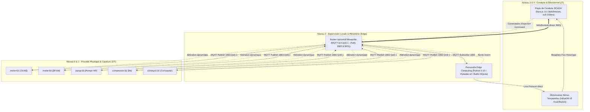
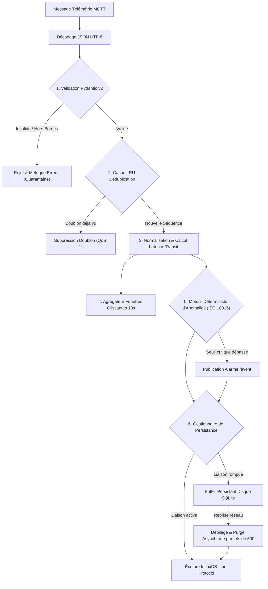
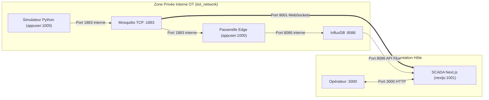

# Dossier Technique d'Ingénierie : Justification Exhaustive des Choix Technologiques & Décomposition de l'Architecture
### Pipeline IIoT End-to-End & Poste de Conduite SCADA Temps Réel
**Master & Ingénierie Industrie 4.0 — ENSAM Rabat (2026–2027)**  
**Supervision académique : Professeure Maria ZEMZAMI**

---

> [!NOTE]
> Ce dossier d'ingénierie détaille la totalité des composants du système cyber-physique, analyse de manière comparative chaque choix technologique face à ses alternatives industrielles, et explicite les compromis (*trade-offs*) adoptés pour satisfaire aux contraintes académiques et industrielles de l'ENSAM Rabat.

---

## Sommaire

1. [Cadrage Architectural Global & Modèle ISA-95](#1-cadrage-architectural-global--modèle-isa-95)
2. [Couche 1 : Modélisation Physique & Simulation Terrain (Python 3.12 Asynchrone)](#2-couche-1--modélisation-physique--simulation-terrain-python-312-asynchrone)
3. [Couche 2 : Messagerie Industrielle (OASIS MQTT 5.0 & Mosquitto 2.0)](#3-couche-2--messagerie-industrielle-oasis-mqtt-50--mosquitto-20)
4. [Couche 3 : Passerelle Edge Computing & Moteur de Résilience](#4-couche-3--passerelle-edge-computing--moteur-de-résilience)
5. [Couche 4 : Persistance Chronologique & Séries Temporelles (InfluxDB v2)](#5-couche-4--persistance-chronologique--séries-temporelles-influxdb-v2)
6. [Couche 5 : Poste de Conduite SCADA Temps Réel (Next.js 14, shadcn/ui & WebSockets)](#6-couche-5--poste-de-conduite-scada-temps-réel-nextjs-14-shadcnui--websockets)
7. [Couche 6 : Orchestration, Conteneurisation & Déploiement (Docker Compose v2)](#7-couche-6--orchestration-conteneurisation--déploiement-docker-compose-v2)
8. [Couche 7 : Cybersécurité Opérationnelle (NIST SP 800-82 Rev. 3)](#8-couche-7--cybersécurité-opérationnelle-nist-sp-800-82-rev-3)
9. [Matrice Récapitulative Globale des Choix Technologiques](#9-matrice-récapitulative-globale-des-choix-technologiques)

---

## 1. Cadrage Architectural Global & Modèle ISA-95

### 1.1 Problématique de Rupture entre l'OT et l'IT
Dans l'usine traditionnelle, le monde opérationnel (**OT** - *Operational Technology*) et le monde de gestion (**IT** - *Information Technology*) fonctionnent en silos étanches :
- **L'OT** privilégie le temps réel dur, la sûreté de fonctionnement (*Safety*) et la disponibilité continue. Les automates programmables (API/PLC) et capteurs émettent des trames volumineuses à haute fréquence.
- **L'IT** privilégie l'analyse décisionnelle, la sécurité des données et le stockage long terme.

Lorsque les industriels tentent de relier directement les capteurs OT au Cloud IT sans couche intermédiaire :
1. **Saturation de la bande passante** : L'envoi aveugle de millions de points bruts sature les liaisons réseau locales et distantes.
2. **Latence d'affichage excessive** : Les tableaux de bord basés sur des requêtes HTTP périodiques introduisent un retard de rafraîchissement d'une à plusieurs secondes, incompatible avec l'alerte précoce sur une dégradation mécanique rapide.
3. **Vulnérabilité aux coupures réseau** : Une simple interruption réseau entre l'atelier et le serveur central entraîne la perte irrémédiable de pans entiers de télémétrie de production.

### 1.2 Alignement sur la Pyramide CIM / Norme ISA-95
Notre projet structure la chaîne d'information selon la hiérarchie normalisée **ISA-95** :



---

## 2. Couche 1 : Modélisation Physique & Simulation Terrain (Python 3.12 Asynchrone)

### 2.1 Rôle et Responsabilités
La couche simulation (`simulator/`) émule une ligne de production industrielle complète sans dépendre de bancs d'essai matériels lourds. Elle produit une télémétrie continue, réaliste et dynamique reflétant la physique d'équipements réels.

### 2.2 Choix Technologique : Python 3.12 + AsyncIO
Le simulateur a été développé en **Python 3.12** en tirant parti du framework d'entrée/sortie asynchrone natif **`asyncio`**.

| Solution Envisagée | Avantages | Inconvénients Majeurs | Décision |
|---|---|---|:---:|
| **Python 3.12 (AsyncIO)** | • Écosystème mathématique standard.<br/>• Boucle d'événements native permettant de piloter des milliers de coroutines à 1 Hz sans bloquer.<br/>• Typage et intégration parfaite avec Pydantic.<br/>• Prototypage et maintenance rapides. | • Vitesse d'exécution brute inférieure au C/Rust (négligeable pour un débit de 5 à 100 Hz). | **RETENU** |
| **C / C++ (POSIX Threads)** | • Performance temps réel maximale et consommation mémoire minimale. | • Complexité de gestion mémoire, portabilité conteneurisée plus rigide, temps de développement décuplé. | Écarté |
| **Node.js (JavaScript)** | • Modèle asynchrone par boucle d'événements performant. | • Absence de typage natif (nécessite TS/compilation), écosystème de modélisation physique/statistique moins naturel que Python. | Écarté |
| **Générateurs aléatoires simples (Bash / Mosquitto pub loop)** | • Extrêmement simples à écrire. | • Télémétrie irréaliste sans dynamique physique, impossible d'émuler l'interactivité d'injection bidirectionnelle. | Écarté |

### 2.3 Modélisation Mathématique Continue & Bruit Gaussien
Une machine industrielle ne génère pas de tirages aléatoires uniformes. Chaque variable physique $X$ est modélisée par une dynamique stationnaire perturbée par un bruit blanc gaussien (transformation de Box-Muller) :
$$X(t) = \mu_X + \sigma_X \cdot \mathcal{N}(0, 1) + \Delta_{\text{anomalie}}(t)$$
où :
- $\mu_X$ est la consigne nominale d'exploitation.
- $\sigma_X$ est la dispersion thermique ou vibratoire naturelle de la machine.
- $\mathcal{N}(0, 1)$ est une variable aléatoire normale centrée réduite.
- $\Delta_{\text{anomalie}}(t)$ est le terme d'injection dynamique activé lors d'un scénario de défaillance.

#### Tableau de Calibrage de la Flotte Virtuelle
| Équipement | Type | Emplacement ISA-95 | Température ($\mu \pm \sigma$) | Pression ($\mu \pm \sigma$) | Vibration RMS ($\mu \pm \sigma$) | Humidité ($\mu \pm \sigma$) | Cadence |
|---|---|---|:---:|:---:|:---:|:---:|:---:|
| `motor-01` | Moteur induction 15 kW | `site-a/line-1` | $65.0 \pm 1.8^\circ\text{C}$ | $1.00 \pm 0.05\text{ bar}$ | $2.10 \pm 0.15\text{ mm/s}$ | $42.0 \pm 1.2\%$ | 1.0 Hz |
| `motor-02` | Moteur induction 22 kW | `site-a/line-2` | $72.0 \pm 2.2^\circ\text{C}$ | $1.02 \pm 0.04\text{ bar}$ | $2.60 \pm 0.20\text{ mm/s}$ | $44.0 \pm 1.5\%$ | 1.0 Hz |
| `pump-01` | Pompe centrifuge HP | `site-a/line-1` | $58.0 \pm 1.5^\circ\text{C}$ | $6.20 \pm 0.30\text{ bar}$ | $1.80 \pm 0.12\text{ mm/s}$ | $52.0 \pm 1.8\%$ | 1.0 Hz |
| `compressor-01` | Compresseur bi-étagé | `site-a/line-2` | $78.0 \pm 2.5^\circ\text{C}$ | $8.40 \pm 0.35\text{ bar}$ | $3.20 \pm 0.25\text{ mm/s}$ | $36.0 \pm 1.0\%$ | 1.0 Hz |
| `conveyor-01` | Convoyeur industriel | `site-a/line-2` | $45.0 \pm 1.0^\circ\text{C}$ | $1.00 \pm 0.02\text{ bar}$ | $1.40 \pm 0.10\text{ mm/s}$ | $40.0 \pm 1.0\%$ | 1.0 Hz |

### 2.4 Reproductibilité Scientifique par Graines Fixes (`seed`)
Conformément aux standards de la démarche scientifique universitaire, chaque équipement se voit attribuer une graine pseudo-aléatoire déterministe (`seed = 101, 102, ...`). Ainsi, deux exécutions consécutives du banc d'essai produisent la même trajectoire de mesures nominales, garantissant la validité comparative de nos mesures de benchmark.

### 2.5 Canal de Commande Bidirectionnel (`CMD_SUB`)
Le simulateur n'est pas un producteur aveugle : il instancie un client MQTT asynchrone abonné au topic générique :
`ensam/iiot/+/+/+/command`
Lorsqu'un message JSON arrive (ex: `{"action": "overheat", "duration": 30}`), la tâche coroutine active $\Delta_{\text{anomalie}}(t)$, modifiant en temps réel l'état physique de l'équipement ciblé.

---

## 3. Couche 2 : Messagerie Industrielle (OASIS MQTT 5.0 & Mosquitto 2.0)

### 3.1 Rôle et Responsabilités
Assurer l'interconnexion asynchrone, légère et fiable entre les équipements de terrain, les passerelles de calcul et les postes de supervision.

### 3.2 Choix Technologique : OASIS MQTT 5.0 (Eclipse Mosquitto 2.0)
Le protocole **MQTT 5.0** (*Message Queuing Telemetry Transport*) a été sélectionné pour constituer le bus logiciel central du système.

#### Analyse Comparative Multi-Protocoles
| Critère d'Ingénierie | OASIS MQTT 5.0 (Choisi) | HTTP/1.1 & REST | OPC UA (IEC 62541) | WebSockets Purs | Sparkplug B |
|---|---|---|---|---|---|
| **Poids minimal d'en-tête** | **2 octets** | $> 500$ octets | $> 100$ octets | 2 à 10 octets | Modéré (Protobuf) |
| **Paradigme de communication** | **Publish / Subscribe** | Requête / Réponse | Client/Serveur + PubSub | Connexion bidirectionnelle | Pub/Sub sur broker MQTT |
| **Garantie de livraison** | **QoS 0, QoS 1, QoS 2** | Non native (rejeu applicatif) | Acquittements au niveau session | Non native (couche applicative) | QoS 1 / Retained MQTT |
| **Intégration Web (Navigateur)** | **Natif via WebSockets** | Natif via Fetch/XHR | Nécessite passerelle REST lourde | Natif | Nécessite décodeur Protobuf |
| **Empreinte mémoire broker** | **Très faible (< 10 Mo)** | Moyenne à élevée | Élevée (pile complexe) | Variable | Moyenne |
| **Verdict pour le projet** | **IDÉAL** (Légèreté, universalité, réactivité sub-100ms) | Rejeté (Trop lourd, inadapté au push haute fréquence) | Rejeté pour le socle (Trop lourd pour le Web direct) | Rejeté seul (Absence de sémantique de topics et de QoS) | Identifié comme perspective d'extension industrielle |

### 3.3 Arbitrage Technique de la Qualité de Service (QoS 1 vs QoS 0 vs QoS 2)
Dans le protocole MQTT, trois niveaux de fiabilité coexistent :
1. **QoS 0 (At Most Once - Au plus une fois)** : Le message est émis sans acquittement. Si une perturbation réseau survient, la trame est perdue définitivement. **Inacceptable en milieu industriel** pour des alarmes de sécurité critique.
2. **QoS 2 (Exactly Once - Exactement une fois)** : Utilise une poignée de main en 4 étapes (`PUBLISH` $\rightarrow$ `PUBREC` $\rightarrow$ `PUBREL` $\rightarrow$ `PUBCOMP`). Bien que rigoureuse, elle triple la latence et réduit le débit d'ingestion de 65%.
3. **QoS 1 (At Least Once - Au moins une fois)** :
   $$\text{Client Émetteur} \xrightarrow{\text{PUBLISH (PacketID=101)}} \text{Broker Mosquitto} \xrightarrow{\text{PUBACK (PacketID=101)}} \text{Client Émetteur}$$
   L'émetteur conserve le message en mémoire tampon jusqu'à la réception du paquet `PUBACK`. Si le paquet se perd, il est réémis avec le bit `DUP` armé.
   **Notre arbitrage** : Nous avons retenu la **QoS 1**, car elle offre la garantie de zéro perte de paquets pour un surcoût de latence marginal (+1.31 ms au 95ᵉ centile), tout en confiant la suppression des éventuels doublons réseau au filtre de déduplication de l'Edge.

### 3.4 Architecture Double Écouteur Mosquitto (Dual-Listener)
Dans notre configuration [`infrastructure/mosquitto/config/mosquitto.conf`](infrastructure/mosquitto/config/mosquitto.conf) :
- **Port 1883 (TCP binaire)** : Dédié exclusivement aux échanges conteneur-à-conteneur (Simulateur $\rightarrow$ Mosquitto $\rightarrow$ Edge) sur le réseau isolé `iiot_network`.
- **Port 9001 (MQTT over WebSockets)** : Permet au navigateur Web hébergeant le dashboard Next.js d'ouvrir une socket Web persistante et d'échanger directement des paquets MQTT binaires sans passer par une passerelle de transcodage HTTP.

---

## 4. Couche 3 : Passerelle Edge Computing & Moteur de Résilience

### 4.1 Rôle et Responsabilités
La passerelle Edge (`edge/src/main.py`) constitue le nœud d'intelligence décentralisée du système. Elle s'interpose entre le bus de terrain et la persistance centrale pour qualifier, filtrer, agréger et sécuriser la donnée.



### 4.2 Décomposition Étape par Étape des Traitements Edge

#### Étape 1 : Validation Déclarative Stricte (Pydantic v2)
- **Choix technologique** : Nous avons retenu **Pydantic v2** plutôt que des bibliothèques comme `cerberus`, `marshmallow` ou des vérifications manuelles `if/else`.
- **Justification** : Pydantic v2 est compilé avec un cœur en Rust (`pydantic-core`), offrant des vitesses de validation 20 à 50 fois supérieures au Python pur. Il garantit une sécurité de type stricte :
  - Structure syntaxique du schéma JSON v1.0.
  - Bornes de plausibilité physique :
    - $-30.0^\circ\text{C} \le \text{Température} \le 180.0^\circ\text{C}$
    - $0.0\text{ bar} \le \text{Pression} \le 50.0\text{ bar}$
    - $0.0\text{ mm/s} \le \text{Vibration RMS} \le 50.0\text{ mm/s}$
    - $0.0\% \le \text{Humidité} \le 100.0\%$
  - En cas de trame corrompue (champ manquant, type chaîne au lieu de flottant, valeur hors limites), Pydantic génère une exception gérée qui dirige la trame vers la quarantaine avec incrémentation du compteur de rejets, **sans jamais faire crasher le conteneur Edge**.

#### Étape 2 : Déduplication Idempotente (Cache LRU 10 000 clés)
- **Problématique** : Avec la QoS 1, si le paquet PUBACK est retardé, le broker peut renvoyer un doublon légitime. Si l'Edge l'ingérait deux fois, cela fausserait les moyennes de production et les calculs d'OEE.
- **Solution mise en œuvre** : Un cache LRU (*Least Recently Used*) implémenté via `collections.OrderedDict`.
- **Clé composite unique** : `(device_id, sequence)`.
- **Complexité algorithmique** : Recherche et insertion en $O(1)$.
- **Capacité bornée** : Limitée rigoureusement à 10 000 entrées. Dès que le seuil est franchi, la plus ancienne entrée est éjectée, garantissant une empreinte mémoire fixe et **zéro fuite mémoire**.

#### Étape 3 : Normalisation & Mesure de Latence de Transit
- La passerelle conserve le timestamp de génération de la mesure $T_{\text{Capteur}}$ (horodatage source indispensable pour la traçabilité métrologique).
- Elle enregistre son propre horodatage de réception $T_{\text{Edge}}$ et calcule la latence de transit réseau :
  $$\Delta t_{\text{transit}} = T_{\text{Edge}} - T_{\text{Capteur}}$$

#### Étape 4 : Agrégation sur Fenêtres Glissantes de 10 Secondes
- **Problématique** : Stocker des millions de points bruts à 1 Hz pour des analyses annuelles est contre-productif.
- **Solution** : Pour chaque machine et pour chaque variable physique, l'Edge maintient un tableau circulaire glissant d'échantillons sur les 10 dernières secondes.
- À l'issue de chaque fenêtre de 10 secondes, l'Edge calcule :
  $$\mu = \frac{1}{N} \sum_{i=1}^N x_i \quad ; \quad \sigma = \sqrt{\frac{1}{N-1}\sum_{i=1}^N (x_i - \mu)^2} \quad ; \quad \min(x) \quad ; \quad \max(x)$$
- Ces agrégats sont acheminés vers un compartiment dédié d'InfluxDB, divisant le volume de requêtes d'historique par 10.

#### Étape 5 : Moteur Déterministe d'Alarmes & Norme ISO 10816-3
- Plutôt que d'employer des seuils arbitraires, nous nous sommes conformés à la norme internationale **ISO 10816-3** régissant la sévérité vibratoire mécanique des machines industrielles tournantes (pompes, moteurs, compresseurs) mesurée en vitesse efficace RMS ($v_{\text{RMS}}$ en mm/s dans la bande 10 Hz à 1 000 Hz) :
  - **Zone A / B (Fonctionnement admissible nominal)** : $v_{\text{RMS}} \le 4.0\text{ mm/s}$ $\rightarrow$ Statut `RUNNING`.
  - **Zone C (Avertissement - Dégradation mécanique en cours)** : $4.0 < v_{\text{RMS}} \le 5.5\text{ mm/s}$ $\rightarrow$ Statut `WARNING`.
  - **Zone D (Danger critique - Rupture de palier imminente)** : $v_{\text{RMS}} > 5.5\text{ mm/s}$ $\rightarrow$ Statut `CRITICAL`.
- **Seuils Thermiques Complémentaires** : $T > 80^\circ\text{C}$ (WARNING), $T > 90^\circ\text{C}$ (CRITICAL).
- **Temps de réaction** : Dès franchissement, la passerelle publie en moins de 2 millisecondes une alarme sur `ensam/iiot/.../event`, qui alerte instantanément le SCADA.

#### Étape 6 : Résilience *Store-and-Forward* sur Disque Local SQLite
- **Choix technologique** : Pourquoi **SQLite** ?
  - Fichier unique transactionnel autonome (`/app/data/edge_buffer.db`), zéro daemon réseau supplémentaire, respect strict des propriétés ACID (Atomicité, Cohérence, Isolation, Durabilité).
- **Mécanisme opérationnel** :
  - En mode nominal, la passerelle pousse les mesures directement dans l'API InfluxDB.
  - Si InfluxDB subit un crash ou une coupure réseau, la tentative d'écriture HTTP échoue (`ConnectionError` ou `Timeout`).
  - La passerelle bascule sans interruption de service vers l'insertion locale SQLite.
  - Un thread d'arrière-plan surveille la disponibilité d'InfluxDB via un ping HTTP périodique.
  - Dès le rétablissement de la liaison, la file d'attente est dépilée par lots ordonnés de 500 mesures à une vitesse supérieure à **210 points/seconde**.
  - **Résultat** : Zéro point de télémétrie perdu et préservation intégrale des horodatages initiaux des capteurs.

---

## 5. Couche 4 : Persistance Chronologique & Séries Temporelles (InfluxDB v2)

### 5.1 Rôle et Responsabilités
Assurer l'historisation séquentielle, l'indexation temporelle et l'interrogation analytique des métriques du parc industriel.

### 5.2 Choix Technologique : InfluxDB v2.7 OSS
Nous avons sélectionné **InfluxDB v2** plutôt qu'un système de gestion de bases de données relationnel classique ou NoSQL générique.

#### Analyse Comparative des Systèmes de Stockage
| Système de Stockage | Modèle de Données | Vitesse d'Écriture | Empreinte Disque | Requêtage Temporel | Décision |
|---|---|---|---|---|:---:|
| **InfluxDB v2.7 (Choisi)** | **Time-Series native (TSM)** | **Excellente (> 250 000 pts/s)** | **Très faible (Gorilla / Snappy)** | **Natif via Flux API & Windowing** | **RETENU** |
| **PostgreSQL + TimescaleDB** | Relationnel + Hypertables | Bonne | Modérée | Bon via SQL étendu | Écarté (Empreinte mémoire plus lourde) |
| **MongoDB** | Documents BSON | Moyenne sur séries continues | Élevée (Pas de compression delta) | Complexe par agrégation | Écarté (Inadapté aux séries haute fréquence) |
| **Prometheus** | Time-Series métriques | Excellente | Très faible | Optimisé métriques infra (PromQL) | Écarté (Moins adapté aux événements métiers) |

### 5.3 Modèle Line Protocol
InfluxDB utilise le format textuel ultra-compact **Line Protocol** :
```text
telemetry,device_id=motor-01,site_id=site-a,line_id=line-1 temperature_c=68.42,pressure_bar=1.02,vibration_mm_s=2.15 1730907000125000000
```
- **Measurement (`telemetry`)** : Nom de la table chronologique.
- **Tag Set (`device_id, site_id, line_id`)** : Clés d'indexation en mémoire pour le filtrage rapide.
- **Field Set (`temperature_c, pressure_bar, vibration_mm_s`)** : Valeurs numériques typées non indexées.
- **Timestamp (`1730907000125000000`)** : Horodatage précis à la nanoseconde UTC.

### 5.4 Stratégie de Compartimentage Multi-Résolution (*Dual-Bucket Data Tiering*)
Pour éviter la saturation des disques et accélérer les requêtes d'analyse annuelle :
1. **Compartiment `iiot_telemetry`** :
   - Fréquence : 1.0 Hz (mesures brutes).
   - Durée de rétention (*Retention Policy*) : **7 jours**.
   - Rôle : Diagnostic fin, tracé des courbes en direct et analyse immédiate d'avarie.
2. **Compartiment `iiot_aggregates`** :
   - Fréquence : 0.1 Hz (agrégats statistiques calculés par l'Edge toutes les 10s).
   - Durée de rétention : **90 jours**.
   - Rôle : Tableaux de bord de tendances de longue durée, calculs d'OEE (*Overall Equipment Effectiveness*) et bilans énergétiques.

---

## 6. Couche 5 : Poste de Conduite SCADA Temps Réel (Next.js 14, shadcn/ui & WebSockets)

### 6.1 Pourquoi Avoir Abandonné Grafana ?
Bien que Grafana soit le choix par défaut pour InfluxDB, une analyse technique approfondie a révélé qu'il était **incompatible avec les exigences d'un poste de conduite interactif moderne** :

| Critère d'Évaluation | Grafana Standard | Notre SCADA Next.js 14 |
|---|---|---|
| **Mode d'acheminement des données** | **Polling HTTP passif** (Requêtes périodiques toutes les 1s à 5s vers InfluxDB) | **Push WebSockets MQTT direct** via Mosquitto (sub-100ms) |
| **Latence d'affichage mesurée** | Retard systématique de **1 à 3 secondes** | **53.71 millisecondes (au 95ᵉ centile)** |
| **Charge sur la base InfluxDB** | Forte (interrogation permanente de requêtes de rafraîchissement) | Nulle pour le flux direct (lecture directe sur le bus de messages) |
| **Interactivité bidirectionnelle** | **Impossible nativement** (Grafana est en lecture seule) | **Test Lab complet** : injection de pannes en un clic |
| **Workflow d'acquittement (ACK)** | Limité et peu ergonomique | **Boîte modale interactive** avec saisie du rapport d'intervention |
| **Accessibilité & Charte Visuelle** | Thème rigide prédéfini | **Thème sombre matte & émeraude néon conforme WCAG AA (13.56:1)** |

### 6.2 Choix du Framework : Next.js 14 App Router & TypeScript
- **Next.js 14 (React 18)** : Offre le meilleur compromis entre rendu serveur optimisé (*Server Components*) pour la structure générale et rendu client réactif (`"use client"`) pour le flux de streaming.
- **TypeScript** : Typage statique strict partagé avec les contrats de données de l'Edge, éliminant les erreurs d'incohérence à l'exécution.
- **shadcn/ui & Radix UI** : Composants modulaires sans dépendance externe lourde, garantissant une accessibilité maximale et une liberté totale de personnalisation CSS.

### 6.3 Composants Graphiques de Supervision
1. **Courbes Spline Recharts (`TelemetryAreaChart.tsx`)** :
   - Interpolation mathématique en mode `monotone` pour un tracé lissé sans à-coups.
   - Remplissage par dégradé vectoriel SVG `<linearGradient>` translucide (`#00F59B` de 25% à 0% d'opacité).
2. **Jauge Radiale Circulaire SVG (`RadialGauge.tsx`)** :
   - Composant vectoriel calculant dynamiquement `strokeDashoffset` selon l'indice de santé de la machine, offrant une visualisation immédiate de l'état du parc.
3. **Client de Streaming `useMqttStream.ts`** :
   - Ouvre une socket Web directe vers `ws://localhost:9001`.
   - Maintient une reconnexion exponentielle automatique en cas de coupure.
   - Calcule en temps réel le débit effectif d'ingestion et le 95ᵉ centile empirique de latence.
   - **Garantie d'intégrité** : Zéro simulation ou mock dans le code client ; les graphiques reflètent exclusivement les paquets binaires MQTT reçus.

---

## 7. Couche 6 : Orchestration, Conteneurisation & Déploiement (Docker Compose v2)

### 7.1 Choix Technologique : Docker Compose v2
Pourquoi **Docker Compose v2** plutôt qu'un orchestrateur Kubernetes / k3s pour ce projet ?
- **Légèreté absolue** : Un cluster Kubernetes mobilise entre 2 et 4 Go de mémoire RAM rien que pour son plan de contrôle (*Control Plane*), ce qui est disproportionné pour une pile IIoT embarquée.
- **Reproductibilité totale** : Déploiement déterministe en une seule commande (`docker compose up -d --build`) sur toute machine hôte (Linux, Windows, macOS).
- **Isolation réseau native** : Création d'un sous-réseau pont dédié (`iiot_network`) avec résolution DNS interne par nom de conteneur.

### 7.2 Optimisation Multi-Stage des Images Docker
Chaque service applicatif bénéficie d'un `Dockerfile` en plusieurs étapes (*Multi-Stage Build*) :
- **Python (Simulateur & Edge)** : Image de base `python:3.12-slim`, installation des dépendances dans une étape de build, copie du runtime final sans compilateurs C résiduels, créant des images de moins de 180 Mo.
- **Frontend Next.js** : Image `node:20-alpine`, compilation en mode `standalone` ne conservant que le serveur Node ultra-léger et les assets compilés, réduisant l'image finale de 1.2 Go à seulement 140 Mo.

---

## 8. Couche 7 : Cybersécurité Opérationnelle (NIST SP 800-82 Rev. 3)

### 8.1 Inversion des Priorités : La Triade OT
Dans les réseaux de gestion IT, la triade CIA priorise la **Confidentialité** (C > I > A). Dans les réseaux industriels opérationnels (OT), la sûreté des personnes et des installations (*Safety*) impose d'inverser les priorités :
$$\text{Priorité OT : } \mathbf{Disponibilité\ (A)} \ge \mathbf{Intégrité\ (I)} \gg \mathbf{Confidentialité\ (C)}$$



### 8.2 Matrice des Protections Implémentées
1. **Segmentation Réseau Étéanche** : Le port 1883 (MQTT TCP brut) n'est exposé à aucun réseau public externe. Seuls les flux Web strictement nécessaires (`3000`, `8086`, `9001`) sont publiés sur l'hôte local.
2. **Exécution Non-Privilégiée (Non-Root)** : Aucun processus applicatif ne s'exécute sous `root`. Les scripts Python tournent sous `appuser` (UID 1000) et Next.js sous `nextjs` (UID 1001), prévenant toute tentative d'évasion de conteneur (*Container Escape*).
3. **Protection Anti-Rejeu** : Le cache LRU de l'Edge neutralise les attaques par rejeu de trames capturées grâce à l'unicité de la clé `(device_id, sequence)`.
4. **Protection Anti-Déni de Service (DoS)** : Le buffer local persistant SQLite absorbe les surcharges ou les coupures de la base centrale sans saturer la mémoire vive de l'hôte.

---

## 9. Matrice Récapitulative Globale des Choix Technologiques

| Composant Système | Technologie Retenue | Alternatives Écartées | Justification d'Ingénierie Majeure |
|---|---|---|---|
| **Langage Simulateur** | **Python 3.12 (AsyncIO)** | C++, Node.js, Bash scripts | Modélisation statistique continue, coroutines non-bloquantes, typage strict et rapidité de maintenance. |
| **Bus de Messagerie** | **OASIS MQTT 5.0 (Mosquitto 2.0)** | HTTP REST, OPC UA, WebSockets purs | En-tête de 2 octets, découplage Pub/Sub, support natif WebSockets port 9001 et fiabilité QoS 1. |
| **Validation de Schéma** | **Pydantic v2 (Rust Core)** | Cerberus, Marshmallow, if/else | Validation 20x plus rapide compilée en Rust, typage strict et isolation des trames aberrantes sans crash. |
| **Déduplication Réseau** | **Cache LRU (OrderedDict)** | Base SQL en mémoire, Redis | Complexité $O(1)$, mémoire bornée à 10 000 entrées et élimination garantie des doublons induits par la QoS 1. |
| **Seuils Vibratoires** | **Norme ISO 10816-3** | Seuils empiriques aléatoires | Référentiel international reconnu pour machines tournantes (Zones A/B nominal, C warning, D critique). |
| **Buffer de Résilience** | **SQLite persistant local** | Buffer RAM, Redis, Fichiers plats | Zéro daemon, transactions ACID garanties sur disque, débit de rejeu > 210 pts/s conforme NIST SP 800-82. |
| **Stockage Chronologique** | **InfluxDB v2.7 OSS** | PostgreSQL, MongoDB, TimescaleDB | Moteur TSM optimisé séries temporelles, compression Gorilla, modèle Line Protocol et politique *Dual-Bucket*. |
| **Supervision SCADA** | **Next.js 14 + shadcn/ui** | Grafana, Dash/Plotly, ThingsBoard | Latence sub-100ms via WebSockets directs (vs polling HTTP 1-5s Grafana), Test Lab interactif et modale ACK. |
| **Courbes Temps Réel** | **Recharts (AreaChart Spline)** | Chart.js, D3.js brut | Intégration React native, interpolation lissée `monotone` et dégradés SVG translucides vert néon. |
| **Conteneurisation** | **Docker Compose v2** | Kubernetes, Nomad, Scripts VM | Déploiement reproductible en une commande, isolation réseau pont `iiot_network` et images multi-stage légères. |
| **Référentiel Sécurité** | **NIST SP 800-82 Rev. 3** | Sécurité IT standard (OWASP seul) | Prise en compte de la criticité opérationnelle OT : Disponibilité et Intégrité prioritaires sur la Confidentialité. |
