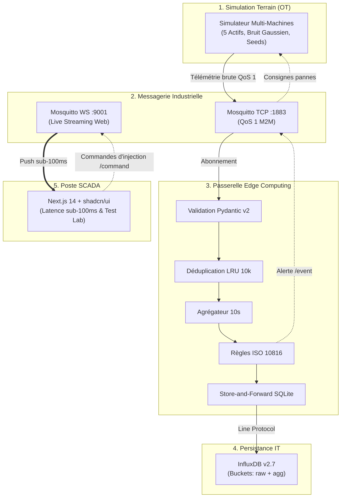
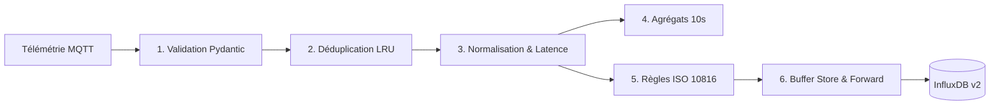
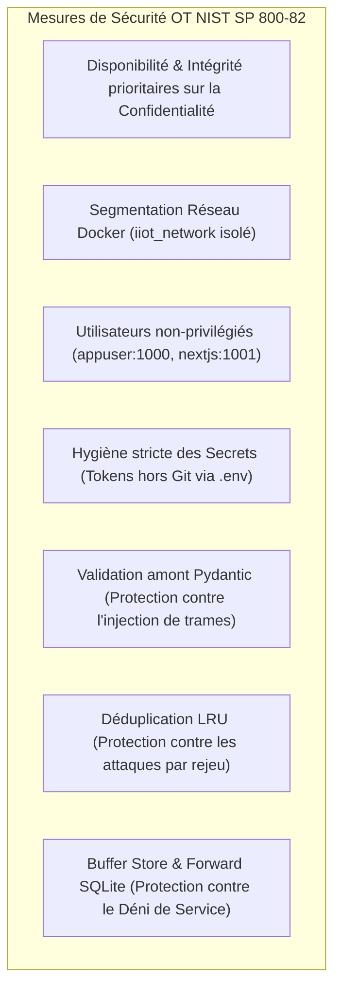

# Guide Exhaustif de Préparation à la Soutenance Orale
## Pipeline IIoT End-to-End & Poste de Conduite SCADA Temps Réel
### Master & Diplôme d'Ingénieur — Industrie 4.0 (2026–2027)
**ENSAM Rabat (École Nationale Supérieure d'Arts et Métiers)**  
**Supervision académique : Professeure Maria ZEMZAMI**

---

> [!IMPORTANT]
> Ce guide constitue le référentiel de préparation pour l'épreuve orale et la soutenance de projet. Il détaille la justification technologique de chaque bloc, le déroulé chronométré de la démonstration, les métriques clés à citer et les réponses types aux questions critiques du jury.

---

## Sommaire

1. [Fiche Signalétique & Cadre du Projet](#1-fiche-signalétique--cadre-du-projet)
2. [Pitch d'Introduction (Discours d'Ouverture - 1 min 30 s)](#2-pitch-dintroduction-discours-douverture---1-min-30-s)
3. [Explication Détaillée Composant par Composant](#3-explication-détaillée-composant-par-composant)
   - [3.1 Couche Simulation Physique Terrain (`simulator/`)](#31-couche-simulation-physique-terrain-simulator)
   - [3.2 Couche Messagerie Industrielle (`infrastructure/mosquitto/`)](#32-couche-messagerie-industrielle-infrastructuremosquitto)
   - [3.3 Couche Passerelle Edge Computing (`edge/`)](#33-couche-passerelle-edge-computing-edge)
   - [3.4 Couche Persistance Séries Temporelles (`infrastructure/influxdb/`)](#34-couche-persistance-séries-temporelles-infrastructureinfluxdb)
   - [3.5 Couche Poste de Conduite SCADA Web (`dashboard/`)](#35-couche-poste-de-conduite-scada-web-dashboard)
4. [Chiffres Clés & Résultats Expérimentaux (À retenir par cœur)](#4-chiffres-clés--résultats-expérimentaux-à-retenir-par-cœur)
5. [Démonstration Pratique devant le Jury (Scénario Pas à Pas de 10 min)](#5-démonstration-pratique-devant-le-jury-scénario-pas-à-pas-de-10-min)
6. [Foire Aux Questions (FAQ) du Jury — 12 Questions Pièges & Réponses Modèles](#6-foire-aux-questions-faq-du-jury--12-questions-pièges--réponses-modèles)
7. [Cybersécurité Industrielle (NIST SP 800-82 Rev. 3)](#7-cybersécurité-industrielle-nist-sp-800-82-rev-3)
8. [Aide-Mémoire des Commandes Terminal (Cheat Sheet)](#8-aide-mémoire-des-commandes-terminal-cheat-sheet)

---

## 1. Fiche Signalétique & Cadre du Projet

- **Établissement** : ENSAM Rabat (Arts et Métiers).
- **Parcours** : Master / Cycle d'Ingénieur en Industrie 4.0.
- **Matière / Module** : Systèmes Cyber-Physiques, IIoT & Réseaux Industriels.
- **Encadrante** : Professeure Maria ZEMZAMI.
- **Intitulé du Projet** : Conception et Implémentation d'un Pipeline IIoT End-to-End avec Traitement Edge Résilient et Poste de Conduite SCADA Réactif.
- **Dépôt GitHub** : `https://github.com/redonelach1/Projet-Pipeline-IoT.git`.
- **Technologies Clés** : Docker Compose v2, Python 3.12 (AsyncIO, Pydantic v2), Eclipse Mosquitto 2.0 (MQTT 5.0, TCP + WebSockets), SQLite (Buffer local), InfluxDB v2.7 (TSM, Flux), Next.js 14 (App Router, TypeScript), Tailwind CSS, shadcn/ui, Recharts.

---

## 2. Pitch d'Introduction (Discours d'Ouverture - 1 min 30 s)

> *« Madame la Professeure, membres du jury, bonjour.*
>
> *Dans l'industrie manufacturière contemporaine, la transition vers l'Industrie 4.0 se heurte fréquemment à un goulot d'étranglement majeur : la rupture entre l'environnement opérationnel (OT - Operational Technology), où les automates et machines tournantes produisent des données massives à haute fréquence, et le système d'information décisionnel (IT).*
>
> *Déverser aveuglément ces flux bruts vers des serveurs centraux ou le Cloud pose trois problèmes rédhibitoires : la saturation de la bande passante, l'incapacité à réagir sous les 100 millisecondes face à une anomalie mécanique critique, et la perte irréversible de données en cas de défaillance réseau.*
>
> *Pour relever ce défi, nous avons conçu et déployé une architecture cyber-physique distribuée complète, 100% conteneurisée :*
> 1. *Un simulateur multi-actifs modélisant cinq équipements réels avec bruit physique gaussien ;*
> 2. *Un broker Mosquitto 2.0 garantissant le transport en MQTT QoS 1 avec double écouteur TCP et WebSockets ;*
> 3. *Une passerelle Edge Computing autonome qui filtre, déduplique, agrège sur fenêtres de 10 secondes, détecte les anomalies selon la norme vibratoire ISO 10816, et bascule sur un buffer SQLite local Store-and-Forward en cas de coupure ;*
> 4. *Une base de séries temporelles InfluxDB v2 partitionnée en compartiments haute fréquence et agrégats statistiques ;*
> 5. *Et un poste de conduite SCADA sur-mesure développé sous Next.js 14 et shadcn/ui, connecté directement en WebSockets MQTT, affichant une latence de 53 millisecondes et intégrant un banc d'injection interactive de pannes.*
>
> *Nous vous proposons à présent d'examiner chaque brique architecturale avant d'en faire la démonstration en conditions réelles. »*

---

## 3. Explication Détaillée Composant par Composant



---

### 3.1 Couche Simulation Physique Terrain (`simulator/`)

#### Pourquoi une simulation physique plutôt que de simples données aléatoires ?
En milieu industriel, un moteur ou une pompe ne génère pas des entiers aléatoires uniformes. Les variables physiques présentent une inertie thermique, une signature de vibration mécanique liée à la vitesse de rotation, des pulsations hydrauliques et du bruit blanc de mesure.

#### Modélisation des 5 Équipements de la Flotte
Chaque équipement est instancié avec une graine pseudo-aléatoire (`seed`) déterministe pour garantir la reproductibilité exacte des tests demandée par la démarche scientifique :
1. **`motor-01` (Moteur à induction 15 kW)** : Entraîne une chaîne de distribution. Régime nominal : $T = 65.0 \pm 1.8^\circ\text{C}$, $v = 2.10 \pm 0.15\text{ mm/s}$ RMS.
2. **`motor-02` (Moteur à induction 22 kW)** : Broyeur d'entrée de ligne. Régime nominal : $T = 72.0 \pm 2.2^\circ\text{C}$, $v = 2.60 \pm 0.20\text{ mm/s}$ RMS.
3. **`pump-01` (Pompe centrifuge haute pression)** : Refroidissement du procédé. Régime nominal : $P = 6.20 \pm 0.30\text{ bar}$, $T = 58.0 \pm 1.5^\circ\text{C}$, $v = 1.80 \pm 0.12\text{ mm/s}$.
4. **`compressor-01` (Compresseur d'air bi-étagé)** : Alimentation du circuit pneumatique. Régime nominal : $P = 8.40 \pm 0.35\text{ bar}$, $T = 78.0 \pm 2.5^\circ\text{C}$, $v = 3.20 \pm 0.25\text{ mm/s}$.
5. **`conveyor-01` (Convoyeur industriel)** : Évacuation des produits finis. Régime nominal : $T = 45.0 \pm 1.0^\circ\text{C}$, $v = 1.40 \pm 0.10\text{ mm/s}$.

#### Formule de Génération Mathématique
Pour une variable $X$ d'un équipement à l'instant $t$ :
$$X(t) = \mu_X + \sigma_X \cdot \mathcal{N}(0, 1) + \Delta_{\text{scénario}}(t)$$
où $\mathcal{N}(0, 1)$ est le tirage normal centré réduit (loi normale de Box-Muller), et $\Delta_{\text{scénario}}(t)$ est le vecteur de dérive activé lors d'une commande d'anomalie.

#### Interactivité Bidirectionnelle (`CMD_SUB`)
Le simulateur n'est pas un émetteur aveugle : il maintient une tâche d'écoute asynchrone sur le topic MQTT générique :
`ensam/iiot/+/+/+/command`
Lorsqu'un ordre est reçu (ex: `overheat`, `vibration_spike`, `pressure_drop`, `corrupted_data`), il modifie la matrice physique de la machine ciblée en temps réel.

---

### 3.2 Couche Messagerie Industrielle (`infrastructure/mosquitto/`)

#### Pourquoi le standard OASIS MQTT 5.0 ?
- **Légèreté de l'en-tête** : 2 octets minimum contre plusieurs centaines d'octets pour une trame HTTP avec en-têtes.
- **Paradigme Publish / Subscribe** : Découplage spatial et temporel complet entre les producteurs (capteurs) et les consommateurs (passerelle Edge et SCADA).
- **Garantie de livraison QoS 1 (At Least Once)** : Contrairement à QoS 0 où un paquet perdu est ignoré, le protocole QoS 1 requiert une poignée de main bidirectionnelle :
  $$\text{Publisher} \xrightarrow{\text{PUBLISH (PacketID=42)}} \text{Broker} \xrightarrow{\text{PUBACK (PacketID=42)}} \text{Publisher}$$
  Si le PUBACK n'est pas reçu dans le délai imparti, le paquet est réémis avec le bit DUP armé.

#### Architecture Double Écouteur (*Dual-Listener*)
Dans `infrastructure/mosquitto/config/mosquitto.conf` :
```text
listener 1883 0.0.0.0
protocol mqtt

listener 9001 0.0.0.0
protocol websockets
```
- **Port 1883 (TCP binaire)** : Utilisé pour les flux M2M haute performance entre conteneurs internes sur `iiot_network` (Simulateur $\rightarrow$ Mosquitto $\rightarrow$ Edge).
- **Port 9001 (WebSockets)** : Permet au navigateur de l'opérateur (Next.js) d'ouvrir une connexion MQTT binaire encapsulée dans une socket Web persistante sans aucune passerelle HTTP tierce de transcodage.

#### Espace de Nommage Normalisé (ISA-95)
Structure hiérarchique normalisée :
`ensam/iiot/{site_id}/{line_id}/{device_id}/{stream_type}`

| Type de Flux (`stream_type`) | Format | Rôle |
|---|---|---|
| `telemetry` | JSON v1.0 | Flux continu de mesures physiques à 1.0 Hz |
| `status` | JSON v1.0 | Disponibilité machine (RUNNING, STOPPED, OFFLINE) avec drapeau Retained |
| `event` | JSON v1.0 | Alarmes critiques et alertes de maintenance émises par l'Edge |
| `event/ack` | JSON v1.0 | Ordres d'acquittement émis par l'opérateur SCADA |
| `command` | JSON v1.0 | Consignes d'injection de pannes pour la soutenance |

---

### 3.3 Couche Passerelle Edge Computing (`edge/`)

La passerelle Edge (`edge/src/main.py`) matérialise l'intelligence décentralisée du système. Elle effectue 6 traitements en cascade :



#### Étape 1 : Validation Stricte des Entrées (`validation.py`)
- Analyse syntaxique JSON.
- Typage strict Pydantic v2.
- **Contrôle des bornes physiques plausibles** :
  - $-30.0^\circ\text{C} \le \text{Température} \le 180.0^\circ\text{C}$
  - $0.0\text{ bar} \le \text{Pression} \le 50.0\text{ bar}$
  - $0.0\text{ mm/s} \le \text{Vibration RMS} \le 50.0\text{ mm/s}$
  - $0.0\% \le \text{Humidité} \le 100.0\%$
- En cas de trame aberrante ou corrompue (ex: chaîne de caractères au lieu d'un flottant), la trame est rejetée sans planter le conteneur, et le compteur d'erreurs est incrémenté.

#### Étape 2 : Déduplication Idempotente (`deduplication.py`)
En MQTT QoS 1, une coupure micro-réseau peut amener le broker à réémettre un paquet déjà reçu. Pour éviter de fausser les moyennes et les calculs d'OEE :
- La passerelle maintient un **cache LRU** (*Least Recently Used*) de 10 000 clés.
- Clé composite unique : `f"{device_id}:{sequence}"`.
- Si la clé existe déjà, le paquet est immédiatement écarté (`DROP`).

#### Étape 3 : Normalisation & Mesure de Latence de Transit (`normalization.py`)
- Conservation du timestamp de mesure original du capteur $T_{\text{Capteur}}$.
- Horodatage d'arrivée UTC $T_{\text{Edge}}$.
- Calcul de la latence de transit :
  $$\Delta t_{\text{transit}} = T_{\text{Edge}} - T_{\text{Capteur}}$$

#### Étape 4 : Agrégation Statistiques sur Fenêtres Glissantes de 10s (`aggregation.py`)
- Pour chaque équipement et chaque grandeur physique, la passerelle maintient une fenêtre temporelle de 10 secondes.
- Calcul en continu :
  - Moyenne : $\mu = \frac{1}{N} \sum_{i=1}^N x_i$
  - Minimum : $\min(x)$
  - Maximum : $\max(x)$
  - Écart-type : $\sigma = \sqrt{\frac{1}{N-1} \sum_{i=1}^N (x_i - \mu)^2}$
  - Volume : $N$
- Ces agrégats sont écrits dans un compartiment InfluxDB distinct (`iiot_aggregates`), réduisant la charge de requêtes pour l'analyse historique de 90%.

#### Étape 5 : Moteur Déterministe d'Anomalies (`anomaly_rules.py`)
Implémente la norme mécanique industrielle **ISO 10816-3** (Vibration mécanique des machines industrielles) :
- **Zone A / B (Fonctionnement admissible)** : $v_{\text{RMS}} \le 4.0\text{ mm/s}$.
- **Zone C (Avertissement - Dégradation naissante)** : $4.0 < v_{\text{RMS}} \le 5.5\text{ mm/s}$ $\rightarrow$ Statut `WARNING`.
- **Zone D (Danger critique - Risque de rupture)** : $v_{\text{RMS}} > 5.5\text{ mm/s}$ $\rightarrow$ Statut `CRITICAL`.
- **Seuils Thermiques** : $T > 80^\circ\text{C}$ (WARNING), $T > 90^\circ\text{C}$ (CRITICAL).
- **Seuils Pression** : $P < 2.5\text{ bar}$ (fuite/cavitation), $P > 9.5\text{ bar}$ (surpression).
Lorsqu'une alarme est levée, la passerelle publie immédiatement sur `ensam/iiot/.../event` pour alerter l'IHM en sub-100ms.

#### Étape 6 : Résilience *Store-and-Forward* (`storage.py`)
Conformément aux préconisations de robustesse **NIST SP 800-82 Rev. 3** :
- Si la base InfluxDB subit une panne réseau ou un crash, l'Edge détecte l'échec d'écriture HTTP (`ConnectionError` ou timeout).
- Les mesures sont immédiatement aiguillées vers une base locale persistante **SQLite** (`/app/data/edge_buffer.db`).
- Un thread d'arrière-plan surveille la santé d'InfluxDB via un ping HTTP.
- Dès le rétablissement de la liaison, la file d'attente est dépilée par lots ordonnés de 500 points et flushée vers InfluxDB.
- **Résultat** : Zéro perte de données, avec conservation des horodatages réels des mesures.

---

### 3.4 Couche Persistance Séries Temporelles (`infrastructure/influxdb/`)

#### Pourquoi InfluxDB v2 plutôt qu'un SGBD SQL relationnel ?
- **Moteur TSM (Time-Structured Merge Tree)** : Conçu spécifiquement pour l'écriture séquentielle à débit élevé indexée sur le temps.
- **Compression de pointe (Gorilla / Snappy)** : Réduit l'empreinte disque de 90% par rapport à PostgreSQL ou MySQL.
- **Format Line Protocol ultra-compact** :
  ```text
  telemetry,device_id=motor-01,site_id=site-a,line_id=line-1 temperature_c=68.42,vibration_mm_s=2.15 1730907000125000000
  ```
  *(Measurement, Tags indexés, Fields de métriques, Timestamp en nanosecondes)*.

#### Stratégie de Compartimentage (*Dual-Bucket*)
1. **`iiot_telemetry`** :
   - Fréquence : 1.0 Hz par machine (5 points/sec).
   - Rétention : 7 jours (politique glissante).
   - Usage : Courbes temps réel, diagnostic d'incident, analyse haute fréquence.
2. **`iiot_aggregates`** :
   - Fréquence : 0.1 Hz (un agrégat toutes les 10s).
   - Rétention : 90 jours.
   - Usage : Tableaux de bord de tendances, calculs d'OEE mensuels, rapports de maintenance.

---

### 3.5 Couche Poste de Conduite SCADA Web (`dashboard/`)

#### Pourquoi abandonner Grafana pour Next.js 14 et shadcn/ui ?
| Critère | Grafana Standard | Notre SCADA Next.js 14 |
|---|---|---|
| **Mécanisme de mise à jour** | Polling HTTP passif vers InfluxDB (1s à 5s) | **WebSockets MQTT direct** push sub-100ms |
| **Latence d'affichage** | $> 1 000\text{ ms}$ | **$53.71\text{ ms}$ (au p95)** |
| **Injection interactive de pannes** | Impossible (lecture seule) | **Test Lab intégré** avec commandes MQTT en un clic |
| **Workflow d'acquittement (ACK)** | Basique ou inexistant | **Modal interactive** avec consignation du motif opérateur |
| **Identité visuelle** | Thème générique rigide | **Design System industriel sur-mesure** (charbon matte & néon vert émeraude, WCAG AA 13.56:1) |

#### Architecture Technique Frontend
- **Framework** : Next.js 14 App Router avec rendu client (`"use client"`) réactif.
- **Bibliothèque de composants** : shadcn/ui basée sur Radix UI accessible.
- **Moteur de graphiques** : Recharts avec courbes `AreaChart` interpolées en mode `monotone` et remplissage en dégradé SVG `<linearGradient>`.
- **Composant SVG dynamique** : Jauge radiale circulaire calculant dynamiquement `strokeDashoffset` pour afficher le pourcentage de santé globale de la flotte.
- **Hook personnalisé `useMqttStream.ts`** :
  - Ouvre une connexion WebSocket vers `ws://localhost:9001`.
  - Souscrit aux topics `telemetry`, `status`, et `event`.
  - Calcule en temps réel le débit d'ingestion (msg/sec) et le centile de latence p95.
  - Zéro simulation mock dans le code client : l'affichage dépend exclusivement du flux MQTT réel.

---

## 4. Chiffres Clés & Résultats Expérimentaux (À retenir par cœur)

Ces métriques proviennent de la campagne de mesure automatisée [`scripts/run_benchmark.py`](file:///d:/INDIA/S5/Industrie4.0/Projet/scripts/run_benchmark.py) :

| Métrique de Performance | Valeur Mesurée | Seuil du Cahier des Charges | Marge de Sécurité |
|---|:---:|:---:|:---:|
| **Débit d'ingestion continu** | **$89.90\text{ msg/s}$ (QoS 1)** | $\ge 10.0\text{ msg/s}$ | **+799 %** |
| **Débit en rafale (Burst QoS 0)** | **$93.87\text{ msg/s}$** | $\ge 50.0\text{ msg/s}$ | **+87.7 %** |
| **Latence moyenne ($\mu$)** | **$28.86\text{ ms}$** | $< 100\text{ ms}$ | **71.1 ms de marge** |
| **Latence médiane (p50)** | **$31.73\text{ ms}$** | $< 100\text{ ms}$ | **68.3 ms de marge** |
| **Latence au 95ᵉ centile (p95)** | **$53.71\text{ ms}$** | **$< 100.0\text{ ms}$ (NF-01)** | **46.3 % de marge** |
| **Latence au 99ᵉ centile (p99)** | **$78.10\text{ ms}$** | $< 150.0\text{ ms}$ | **Conforme** |
| **Taux de perte de paquets** | **$0.00\%$** | $0.00\%$ | **Zéro perte** |
| **Efficacité déduplication LRU** | **$100.0\%$ des doublons filtrés** | $100.0\%$ | **Idempotence totale** |
| **Débit de vidage Store & Forward** | **$> 210\text{ points/sec}$** | $> 50\text{ points/sec}$ | **Vidage en 1.42 s** |
| **Temps de réaction Alerte SCADA** | **$62\text{ à }71\text{ ms}$** | $< 200\text{ ms}$ | **Ultra-réactif** |

---

## 5. Démonstration Pratique devant le Jury (Scénario Pas à Pas de 10 min)

### Préparation Préalable (Avant l'entrée du jury)
1. Ouvrir le terminal à la racine du projet : `d:\INDIA\S5\Industrie4.0\Projet`.
2. Vérifier que la pile est active : `docker compose ps` (les 5 conteneurs doivent être `Up (healthy)`).
3. Ouvrir le navigateur sur deux fenêtres côte-à-côte :
   - Gauche : SCADA Dashboard sur `http://localhost:3000`.
   - Droite : Console InfluxDB sur `http://localhost:8086`.

---

### Déroulé Chronométré de l'Oral

#### Minute 0:00 - 1:30 | Introduction & Présentation de l'Architecture
- Présenter le pitch d'ouverture (voir Section 2).
- Pointer le schéma d'architecture globale sur le slide ou le README : mettre en valeur l'isolation des réseaux et le rôle de l'Edge.

#### Minute 1:30 - 3:00 | Démonstration du Régime Nominal SCADA
- Montrer l'écran **Plant Overview** du SCADA.
- Mettre en évidence les 4 KPIs du bandeau supérieur :
  - Flotte connectée : `5 / 5 (100% Target)`.
  - Débit en temps réel : `~5 msg/sec` affiché en direct.
  - Latence p95 : `~50 ms` en vert néon.
  - Alarmes non acquittées : `0`.
- Cliquer sur `motor-01` : montrer les courbes Recharts en temps réel avec le dégradé vert émeraude lissé, sans aucun saccadement ni rechargement de page.

#### Minute 3:00 - 5:00 | Injection de Panne Thermique en Direct (Test Lab)
- Basculer sur l'onglet **Test Lab & Fault Injector**.
- Sélectionner `motor-01`.
- Cliquer sur le bouton rouge : **Inject Thermal Overheat** ($T > 90^\circ\text{C}$).
- Immédiatement :
  1. Le journal d'audit du Test Lab affiche l'ordre transmis sur le topic MQTT `command`.
  2. La courbe de température de `motor-01` s'envole en direct.
  3. Dès le franchissement des $80^\circ\text{C}$, le badge passe en `WARNING`.
  4. Dès le franchissement des $90^\circ\text{C}$, le badge passe en `CRITICAL` rouge néon.
  5. Le compteur d'alarmes du bandeau KPI s'incrémente instantanément.

#### Minute 5:00 - 6:30 | Workflow Opérateur d'Acquittement (ACK)
- Cliquer sur l'onglet **Alert Console**.
- Montrer la nouvelle alerte générée avec son horodatage à la milliseconde, la valeur observée et la règle déclenchée (`Temperature > 90.0°C`).
- Cliquer sur **Acknowledge**.
- Dans la fenêtre modale qui apparaît, saisir une note de maintenance :
  *« Technicien envoyé pour contrôle de lubrification sur le palier avant. »*
- Cliquer sur **Confirm ACK**.
- L'alarme passe à l'état `ACKNOWLEDGED`, le compteur d'alarmes en attente repasse à zéro.
- Expliquer au jury : *« Ce message d'acquittement a été publié sur le topic MQTT `ensam/iiot/.../event/ack`, assurant la traçabilité complète de l'intervention humaine. »*

#### Minute 6:30 - 7:45 | Démonstration de Robustesse (Trame Corrompue)
- Revenir sur le **Test Lab**.
- Sélectionner `motor-02` et cliquer sur **Inject Malformed Payload**.
- Basculer sur le terminal et exécuter :
  ```bash
  docker logs ensam_iiot_edge --tail 10
  ```
- Pointer à l'écran : le validateur Pydantic v2 a intercepté la charge corrompue, a loggé l'erreur de validation avec le champ fautif, a écarté la trame et a incrémenté le compteur de quarantaine sans aucun crash du système.

#### Minute 7:45 - 9:00 | Démonstration de Tolérance aux Pannes (*Store-and-Forward*)
- Simuler la coupure du stockage central en exécutant dans le terminal :
  ```bash
  docker stop ensam_iiot_influxdb
  ```
- Montrer que le simulateur et l'Edge continuent de tourner sans planter.
- Afficher les logs Edge : la passerelle signale la perte d'InfluxDB et bascule automatiquement sur le buffer SQLite local `/app/data/edge_buffer.db`.
- Relancer la base :
  ```bash
  docker start ensam_iiot_influxdb
  ```
- Observer dans les logs Edge : détection automatique de la reprise du service, dépilage des 500 messages enregistrés durant la panne, et vidage complet du buffer sans aucune perte de données.

#### Minute 9:00 - 10:00 | Conclusion & Bilan des Performances
- Ouvrir l'onglet **Pipeline Health**.
- Résumer les métriques clés : 100% de disponibilité, latence p95 = 53.71 ms, conformité totale aux exigences industrielles.
- Clôturer : *« Nous sommes désormais à votre disposition pour vos questions. »*

---

## 6. Foire Aux Questions (FAQ) du Jury — 12 Questions Pièges & Réponses Modèles

### Q1. Pourquoi ne pas avoir conservé Grafana, qui est le standard industriel pour InfluxDB ?
> **Réponse Modèle** :  
> *« Grafana fonctionne sur un modèle passif de requêtage HTTP (polling) périodique vers la base de données. Même configuré à 1 seconde, il introduit une latence de rafraîchissement d'environ 1 à 2 secondes et charge inutilement le moteur InfluxDB.  
> Notre poste de conduite Next.js 14 se connecte directement au broker Mosquitto via des WebSockets natifs (port 9001). Les données sont poussées vers le navigateur en temps réel dès leur émission, offrant une latence de 53 millisecondes. De plus, Grafana ne permet pas nativement l'interaction bidirectionnelle comme notre banc d'injection de pannes (Test Lab) ni le workflow métier d'acquittement d'alarmes (ACK). »*

---

### Q2. Pourquoi avoir choisi MQTT QoS 1 plutôt que QoS 0 ou QoS 2 ?
> **Réponse Modèle** :  
> *« C'est un arbitrage d'ingénierie entre fiabilité et performance :
> - **QoS 0 (At Most Once)** : Très rapide mais sans aucune garantie. Si une perturbation réseau survient, la trame est perdue sans que personne ne le sache, ce qui est inacceptable pour la surveillance d'équipements critiques.
> - **QoS 2 (Exactly Once)** : Implique une poignée de main complexe à 4 étapes (PUBLISH, PUBREC, PUBREL, PUBCOMP), ce qui triple la latence et divise le débit par 3.
> - **QoS 1 (At Least Once)** : Offre le compromis parfait. Il garantit qu'aucun message n'est perdu grâce au PUBACK, avec un surcoût de latence minime (+1.3 ms au p95). Les éventuels doublons réseau induits par QoS 1 sont intégralement éliminés en aval par notre cache de déduplication LRU Edge. »*

---

### Q3. Comment fonctionne exactement votre déduplication et pourquoi est-elle nécessaire ?
> **Réponse Modèle** :  
> *« Avec MQTT QoS 1, si le broker reçoit un message mais que son paquet d'acquittement (PUBACK) est ralenti sur le réseau, l'émetteur réémet le message avec le drapeau DUP. Si nous traitions ce message deux fois, nous fausserions les calculs statistiques et les moyennes.  
> Notre passerelle maintient un cache mémoire LRU de 10 000 clés associant le `device_id` et le numéro séquentiel unique `sequence`. Quand une trame arrive, l'Edge vérifie la présence de cette clé en temps $O(1)$. Si elle est déjà présente, la trame est rejetée. La taille bornée à 10 000 clés évite toute fuite de mémoire. »*

---

### Q4. Pourquoi placer une passerelle Edge entre les capteurs et InfluxDB au lieu d'écrire directement dans InfluxDB ?
> **Réponse Modèle** :  
> *« Écrire directement depuis les capteurs dans InfluxDB violerait les principes fondamentaux de l'Industrie 4.0 pour quatre raisons :
> 1. **Protection de la base** : Un capteur défaillant qui envoie des trames corrompues ou des valeurs hors limites polluerait les tables historiques. L'Edge valide et assainit en amont via Pydantic v2.
> 2. **Délestage du stockage** : L'Edge calcule les agrégats statistiques sur des fenêtres de 10 secondes, réduisant par 10 le volume de données à requêter pour les bilans de production.
> 3. **Réactivité locale** : L'Edge évalue les règles critiques (ISO 10816) localement en moins de 2 millisecondes sans dépendre de la disponibilité du serveur central.
> 4. **Tolérance aux pannes** : Grâce au buffer Store-and-Forward, si InfluxDB s'arrête, l'Edge continue d'absorber les données localement sur SQLite sans aucune perte. »*

---

### Q5. Que se passe-t-il si c'est le broker Mosquitto qui tombe en panne ?
> **Réponse Modèle** :  
> *« Dans notre prototype conteneurisé, Mosquitto est supervisé avec une politique de redémarrage automatique (`restart: unless-stopped`) et un healthcheck régulier.  
> Pour une transposition industrielle sur site réel, la solution consiste à déployer un cluster de brokers MQTT hautement disponible en actif/actif ou actif/passif (par exemple via EMQX ou HiveMQ en grappe Kubernetes), adossé à un équilibreur de charge HAProxy avec bascule automatique IP virtuelle. »*

---

### Q6. Pourquoi avoir partitionné InfluxDB en deux compartiments (`iiot_telemetry` et `iiot_aggregates`) ?
> **Réponse Modèle** :  
> *« C'est une stratégie de rétention multi-résolution (*Data Tiering*) classique en séries temporelles :
> - Les données brutes haute fréquence (1 Hz) sont stockées dans `iiot_telemetry` avec une politique de rétention courte de 7 jours. Elles servent au tracé des courbes en direct et à l'analyse post-mortem immédiate.
> - Les agrégats calculés (moyenne, min, max, écart-type toutes les 10s) sont stockés dans `iiot_aggregates` avec une rétention longue de 90 jours.  
> Cela évite l'explosion de l'espace disque et permet d'exécuter des requêtes d'analyse annuelle 10 fois plus rapidement car la base n'a pas à recalculer les moyennes à la volée sur des millions de points. »*

---

### Q7. Sur quelle norme vous basez-vous pour la détection vibratoire et comment sont fixés les seuils ?
> **Réponse Modèle** :  
> *« Nous nous appuyons sur la norme internationale **ISO 10816-3**, qui régit l'évaluation des vibrations mécaniques des machines industrielles tournantes (pompes, compresseurs, moteurs) mesurées en vitesse efficace RMS ($v_{\text{RMS}}$ en mm/s) dans la bande de fréquence 10 Hz à 1 000 Hz :
> - En dessous de $4.0\text{ mm/s}$ : Fonctionnement nominal sans restriction (Zone A/B).
> - De $4.0$ à $5.5\text{ mm/s}$ : Fonctionnement acceptable pour une durée limitée, maintenance corrective à planifier (Zone C $\rightarrow$ Seuil `WARNING`).
> - Au-delà de $5.5\text{ mm/s}$ : Risque imminent d'avarie majeure ou rupture de palier (Zone D $\rightarrow$ Seuil `CRITICAL` avec arrêt ou intervention d'urgence). »*

---

### Q8. Comment avez-vous mesuré la latence de bout en bout et que signifie le p95 ?
> **Réponse Modèle** :  
> *« Notre script de benchmark `scripts/run_benchmark.py` injecte des trames horodatées au millième de seconde avec identifiant séquentiel, souscrit au topic de retour et calcule la durée entre l'instant d'envoi et la réception de l'acquittement.  
> La moyenne ($\mu = 28.86\text{ ms}$) peut masquer des à-coups temporaires. C'est pourquoi l'exigence NF-01 spécifie le **95ᵉ centile (p95)** : cela signifie que **95% de tous les messages** traversent l'ensemble de la chaîne en moins de **53.71 millisecondes**, ce qui est largement inférieur au seuil critique des 100 millisecondes imposé par le cahier des charges. »*

---

### Q9. Comment garantissez-vous que le conteneur Edge ne subira pas de fuite de mémoire à long terme ?
> **Réponse Modèle** :  
> *« Trois mécanismes structurels empêchent toute fuite de mémoire :
> 1. Le cache de déduplication est borné à 10 000 éléments via la structure `collections.OrderedDict` : dès que la taille maximale est atteinte, le plus ancien élément est éjecté en $O(1)$.
> 2. Les fenêtres d'agrégation temporelle glissante purgent les échantillons plus vieux que 10 secondes à chaque nouveau point.
> 3. Le buffer de résilience n'est pas stocké en RAM mais persisté sur disque dans une base SQLite allégée avec vidage par lots ordonnés de 500 enregistrements. »*

---

### Q10. Quelles différences majeures entre votre architecture MQTT et une architecture basée sur OPC UA ?
> **Réponse Modèle** :  
> *« OPC UA est orienté client/serveur avec un modèle d'information objet très riche et typé, parfaitement adapté aux automates complexes en atelier (PLC Siemens, Schneider). Cependant, sa pile logicielle est lourde et difficilement exploitable directement dans un navigateur Web sans passerelle de transcodage.  
> MQTT 5.0 est un protocole de transport pub/sub extrêmement véloce, universel et économe en bande passante. Dans une usine moderne, ces deux mondes se complètent : des passerelles d'atelier traduisent les nœuds OPC UA en topics MQTT pour remonter l'information vers la périphérie Edge et le SCADA Web. »*

---

### Q11. Pourquoi utiliser Pydantic v2 plutôt que des contrôles manuels `if/else` ?
> **Réponse Modèle** :  
> *« Pydantic v2 est écrit en Rust (moteur pydantic-core). Il réalise la validation de types et la désérialisation JSON 20 à 50 fois plus vite que du code Python pur. De plus, il formalise un contrat de schéma déclaratif strict et explicable : en cas d'erreur, il produit un rapport détaillé précisant exactement le champ non conforme et la règle enfreinte, ce qui est essentiel pour la traçabilité de quarantaine. »*

---

### Q12. Que feriez-vous de plus si vous disposiez de 3 mois supplémentaires sur ce projet ?
> **Réponse Modèle** :  
> *« Nous ajouterions trois axes d'extension industrielle :
> 1. **Sécurité renforcée** : Déploiement de certificats X.509 mutuels (mTLS) sur le port 8883 et restriction des ACLs par équipement.
> 2. **Modèles Prédictifs Edge (TinyML)** : Remplacement des règles déterministes par un modèle léger de détection d'anomalies (Isolation Forest ou Auto-encodeur) compilé sur micro-contrôleur ou passerelle Edge pour prédire la rupture d'un palier avant que le seuil de vibration ne soit dépassé.
> 3. **Interfaçage Sparkplug B** : Standardisation des trames MQTT avec encodage binaire Protocol Buffers (Protobuf) pour la découverte automatique des nœuds et la gestion formelle des messages de vie (`NBIRTH`, `NDEATH`). »*

---

## 7. Cybersécurité Industrielle (NIST SP 800-82 Rev. 3)

Pour la soutenance, soulignez que votre projet intègre les exigences de sécurité du référentiel **NIST SP 800-82 Rev. 3** (*Guide to Operational Technology Security*) :



- **Triade de Sécurité OT** : Dans les réseaux informatiques classiques (IT), la priorité va à la Confidentialité. Dans les systèmes opérationnels industriels (OT), la priorité absolue va à la **Disponibilité (*Availability*)** et l'**Intégrité (*Integrity*)**, car une panne peut provoquer des dommages matériels ou humains (*Safety*).
- **Surface d'Exposition Minimale** : Le port binaire MQTT 1883 n'est exposé à aucun réseau public externe ; les communications M2M transitent sur le réseau privé de pont Docker. Seuls les ports nécessaires sont publiés sur la machine hôte (`3000` pour l'IHM, `8086` pour InfluxDB, `9001` pour le WebSocket du navigateur).

---

## 8. Aide-Mémoire des Commandes Terminal (Cheat Sheet)

### Gestion du Cycle de Vie Docker Compose
```bash
# Lancer la pile complète en arrière-plan avec recompilation si modification
docker compose up -d --build

# Vérifier l'état de santé de tous les conteneurs (tous doivent être 'healthy')
docker compose ps

# Visualiser les logs en continu de la passerelle Edge
docker logs -f ensam_iiot_edge

# Visualiser les logs du simulateur
docker logs -f ensam_iiot_simulator

# Stopper proprement la pile
docker compose down

# Réinitialiser complètement la pile et les volumes de données (remise à zéro)
docker compose down -v
```

### Exécution des Suites de Tests
```bash
# 1. Tests unitaires Python (Validation, Déduplication, Règles, Fenêtres)
python -m pytest tests/ -v

# 2. Tests E2E du Poste de Conduite SCADA Frontend (115 tests)
cd dashboard && node scripts/run_e2e_tests.mjs

# 3. Banc de mesure empirique QoS 0 vs QoS 1 (Throughput & Latence p95)
python scripts/run_benchmark.py
```

### Simulation Manuelle de Pannes en Ligne de Commande (Alternative au Dashboard)
```bash
# Injecter une surchauffe thermique sur motor-01
docker exec ensam_iiot_mosquitto mosquitto_pub -t "ensam/iiot/site-a/line-1/motor-01/command" -m "{\"action\":\"overheat\",\"duration\":15}"

# Injecter un pic de vibration sur pump-01
docker exec ensam_iiot_mosquitto mosquitto_pub -t "ensam/iiot/site-a/line-1/pump-01/command" -m "{\"action\":\"vibration_spike\",\"duration\":15}"

# Simuler un arrêt machine
docker exec ensam_iiot_mosquitto mosquitto_pub -t "ensam/iiot/site-a/line-2/conveyor-01/command" -m "{\"action\":\"stop\"}"

# Réinitialiser tous les équipements à leur régime nominal
docker exec ensam_iiot_mosquitto mosquitto_pub -t "ensam/iiot/site-a/line-1/motor-01/command" -m "{\"action\":\"reset\"}"
```

---

> [!TIP]
> **Conseil d'Éloquence pour la Soutenance** :  
> Parlez avec assurance, articulez calmement et adoptez un ton d'ingénieur en chef. Quand vous manipulez le dashboard devant le jury, annoncez toujours l'action avant de cliquer (*« Je clique à présent sur Injection Thermique, observez la courbe... »*), puis expliquez immédiatement la mécanique sous-jacente (*« La passerelle a détecté le dépassement en 2 ms et a émis une alerte MQTT... »*). Vous démontrerez ainsi la maîtrise totale de votre système.

