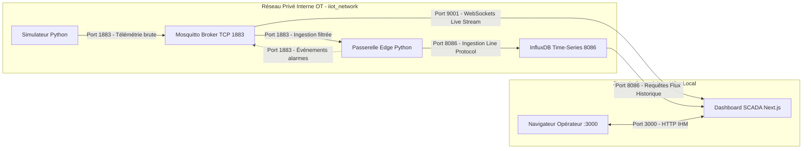

# Cybersécurité & Conformité NIST SP 800-82 Rev. 3
## Guide de Sécurité des Systèmes Opérationnels (OT) appliqué au Pipeline IIoT
**ENSAM Rabat — Industrie 4.0 (2026–2027)**

---

## 1. Référentiel Normatif : NIST SP 800-82 Rev. 3

Le guide **NIST SP 800-82 Rev. 3** (*Guide to Operational Technology Security*, 2023) définit les principes fondamentaux de sécurisation des réseaux industriels (SCADA, DCS, PLC et IIoT). Contrairement aux systèmes informatiques traditionnels (IT) qui privilégient la Confidentialité dans la triade CIA, les systèmes OT privilégient la **Disponibilité (Availability)** et l'**Intégrité (Integrity)** afin de garantir la sûreté de fonctionnement (*Safety*) des installations physiques.

---

## 2. Modélisation des Menaces Spécifiques au Pipeline IIoT

| Vecteur d'Attaque / Menace | Impact Potentiel sur le Procédé | Mesure de Protection Appliquée dans le Prototype |
|---|---|---|
| **Injection de trames corrompues ou hors limites** | Déstabilisation du moteur de calcul, injection SQL/NoSQL, ou fausses alertes d'arrêt d'urgence. | **Validation Pydantic v2 stricte** en bordure de réseau (Edge) rejetant les types incohérents et valeurs hors bornes physiques plausibles avant toute écriture en base. |
| **Attaque par rejeu (Replay Attack) ou doublons réseau** | Comptabilisation erronée des indicateurs KPI de production et perturbation de la traçabilité. | **Moteur de déduplication LRU idempotent** basé sur la clé composite unique `(device_id, sequence)` mémorisée sur 10 000 transactions. |
| **Interruption ou saturation de la base de stockage (Déni de Service)** | Perte irrémédiable de données télémétriques et interruption de la supervision d'usine. | **Buffer local persistant SQLite (Store-and-Forward)** : absorption locale des flux et rejeu différé sans aucune perte de points lors de la reprise. |
| **Écoute passive et compromission du réseau de terrain** | Espionnage des cadences de production et analyse des vulnérabilités machines. | **Segmentation réseau Docker isolée (`iiot_network`)** : le port de télémétrie interne 1883 n'est pas routé sur l'Internet public ; seuls les flux Web nécessaires sont publiés. |
| **Élévation de privilèges via conteneurs compromis** | Prise de contrôle de l'hôte physique par évasion de conteneur (*Container Escape*). | **Exécution non privilégiée systématique** : conteneurs s'exécutant sous des identifiants non-root dédiés (`appuser` UID 1000 pour Python et `nextjs` UID 1001 pour l'IHM). |
| **Fuite de secrets et jetons d'authentification** | Accès non autorisé aux bases de données ou modification des règles d'alarme. | **Hygiène stricte des identifiants** : exclusion de tout fichier `.env`, token InfluxDB ou mot de passe du versionnement Git (`.gitignore`). |

---

## 3. Matrice de Segmentation & Flux Réseau Autorisés

### Règles de Filtrage des Ports
- **Port 1883 (MQTT TCP)** : Réservé exclusivement à la communication inter-conteneurs au sein de `iiot_network`.
- **Port 9001 (MQTT WebSockets)** : Accessible depuis l'hôte local pour alimenter le composant client React `useMqttStream.ts`.
- **Port 8086 (InfluxDB HTTP API)** : Accessible en local pour la console d'administration et les Server Actions Next.js.
- **Port 3000 (SCADA Next.js)** : Interface opérateur exposée en local.

---

## 4. Recommandations pour le Passage à l'Échelle Industrielle (Roadmap de Durcissement)

Dans le cadre d'un déploiement industriel sur site réel (hors prototype simulé) :
1. **Activation de TLS 1.3** sur le broker Mosquitto (port 8883) avec certificats X.509 mutuels (mTLS) pour authentifier formellement chaque capteur physique.
2. **Gestion fine des Listes de Contrôle d'Accès (ACL)** : restreindre les droits d'écriture des capteurs à leur topic strict (`topic write ensam/iiot/%u/...`), interdisant à un capteur de publier des ordres sur les topics des autres machines.
3. **Chiffrement au repos (*Encryption-at-Rest*)** des volumes de données InfluxDB et du buffer local SQLite.
4. **Intégration d'un SIEM industriel** pour la corrélation des journaux de connexion et la détection d'anomalies de communication.
